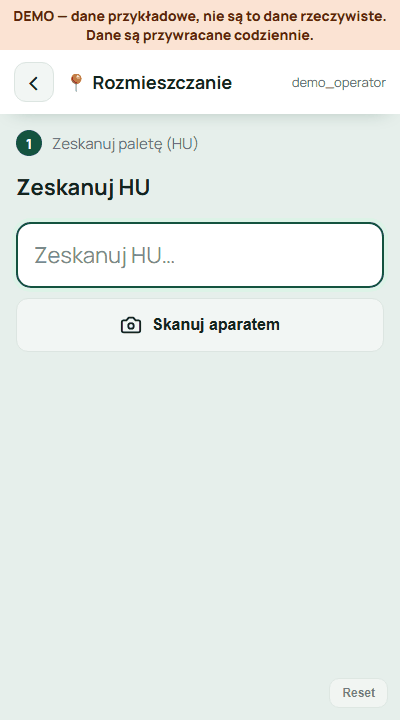

# miniWMS

**Porządkuje przepływ materiałów w małym magazynie, który do tej pory prowadził ewidencję na
kartce papieru — dla magazynierów i kierowników.**



📹 [Prezentacja działania — 2 min, z napisami](docs/video/miniwms-demo.mp4)

🌐 **Demo online: <https://miniwms.twapp.pl>** — loginy `demo_operator` (Operator) i
`demo_podglad` (Podgląd), hasło `demo1234`; skaner: <https://miniwms.twapp.pl/skaner/>.
Dane są fikcyjne i wracają do stanu początkowego codziennie o 3:00.

## Problem → rozwiązanie

Około dwustu palet, trzydzieści nowych tygodniowo i dwóch operatorów na zmiany — a
ewidencja na papierze: palety bez etykiet, miejsce towaru w pamięci jednej osoby, brak
historii i wydawanie bez względu na datę ważności. miniWMS daje każdej palecie numer i
etykietę z kodem QR, zapisuje jej miejsce po zeskanowaniu telefonem i przy wydaniu sam
wybiera palety z najkrótszą datą ważności. Każda zmiana stanu zostawia ślad: kto, kiedy,
ile, skąd i dokąd.

## Dokumentacja analityczna

| Dokument | Co zawiera |
|---|---|
| [01 — Problem i zakres](docs/01-problem-i-zakres.md) | problem, interesariusze, słownik pojęć, co jest w zakresie, a co poza nim i dlaczego |
| [02 — Proces](docs/02-proces.md) | proces przed i po wdrożeniu (Mermaid), aktorzy, punkty decyzyjne, założenia |
| [03 — User flow](docs/03-user-flow.md) | mapa ekranów panelu i skanera z przejściami, ścieżki alternatywne i ślepe |
| [04 — Model danych](docs/04-model-danych.md) | diagram ERD, opis 13 encji, reguły integralności i ich luki |
| [05 — Wymagania](docs/05-wymagania.md) | 26 wymagań z kryteriami akceptacji i wskazaniem kodu oraz testu |
| [06 — Decyzje](docs/06-decyzje.md) | dziennik decyzji: kontekst, opcje, uzasadnienie, skutki |
| [07 — Ograniczenia](docs/07-ograniczenia.md) | czego aplikacja nie robi, znane problemy, co dalej |

## Jak uruchomić

Wymagany Python 3.11+. Komendy przetestowane od zera w czystym katalogu.

```bash
git clone https://github.com/TomaszWu14/miniWMS-public.git
cd miniWMS-public
python -m venv .venv
source .venv/bin/activate              # Windows PowerShell: .venv\Scripts\Activate.ps1
pip install -r requirements.txt

export DEMO_MODE=1                     # Windows PowerShell: $env:DEMO_MODE=1
python manage.py migrate
python manage.py seed_demo             # fikcyjne dane: 15 materiałów, ~30 palet, 3 wydania, otwarty spis
python manage.py runserver
```

Aplikacja: <http://127.0.0.1:8000/> · skaner: <http://127.0.0.1:8000/skaner/>

| Login | Rola | Hasło |
|---|---|---|
| `demo_operator` | Operator — przyjęcia, rozmieszczanie, wydania, skaner | `demo1234` |
| `demo_podglad` | Podgląd — tylko odczyt | `demo1234` |

Bez `DEMO_MODE` aplikacja startuje z pustą bazą — konto administratora:
`python manage.py createsuperuser`. Testy: `pip install -r requirements-dev.txt` i
`python -m pytest -q`. Wdrożenie na serwer (Docker, Coolify), zmienne środowiskowe i
struktura kodu: [docs/wdrozenie.md](docs/wdrozenie.md).

[](https://github.com/TomaszWu14/miniWMS-public/actions/workflows/ci.yml)

## Stack i dlaczego taki

| Element | Dlaczego |
|---|---|
| **Python + Django** | gotowe logowanie, role, formularze i panel administracyjny — czas idzie w reguły magazynu, nie w infrastrukturę |
| **Transakcje i blokady wierszy** | zmiana stanu palety i wpis w historii zapisują się razem; dwa równoczesne wydania z tej samej palety nie zejdą poniżej jej stanu |
| **PostgreSQL** (SQLite lokalnie) | reguły pilnowane też przez bazę: ilość ≥ 0, unikalne numery palet i dokumentów |
| **ReportLab + qrcode** | etykiety palet i dokument WZ jako PDF z kodem QR, bez zewnętrznych usług |
| **openpyxl, CSV** | firma nie ma ERP — dane wchodzą i wychodzą przez pliki, które da się przygotować w arkuszu |
| **Skaner w przeglądarce (jsQR)** | telefon zamiast dedykowanego terminala; te same reguły co w panelu |
| **Docker Compose + Caddy / Coolify** | jedno polecenie na serwerze, automatyczny HTTPS (wymagany przez kamerę) |
| **GitHub Actions** | testy, lint, kontrola migracji i konfiguracji produkcyjnej przy każdej zmianie |

## Zakres i ograniczenia

W zakresie: przyjęcia z etykietami, rozmieszczanie, wydania z doborem palet według daty
ważności, korekty, łączenie palet, spis z natury, raporty i eksport.

Poza zakresem świadomie: integracja z ERP (firma go nie ma), zwroty, blokada palet po terminie
ważności, wiele magazynów. Wszystkie spisane wymagania są spełnione; otwarte pozostają
problemy, które wymagają decyzji (m.in. limit logowań za proxy, import stanów z ilością 0).
Status: zaawansowany prototyp.
Szczegóły: [07 — Ograniczenia](docs/07-ograniczenia.md).

## Kontekst projektu

Projekt własny, oparty na moim doświadczeniu z pracy w magazynie. Aplikacja nie była wdrożona
w firmie — proces, skala i wymagania w dokumentacji pochodzą z tej obserwacji.

Nazwy firm są zamienione na fikcyjne, a dane demo i testowe są syntetyczne. Kod udostępniony
do wglądu, wszelkie prawa zastrzeżone — patrz [LICENSE](LICENSE). Repozytorium zawiera też
konfigurację pracy z asystentem AI (`.claude/`, `CLAUDE.md`, `docs/pitfalls/`,
`docs/operator/`).
