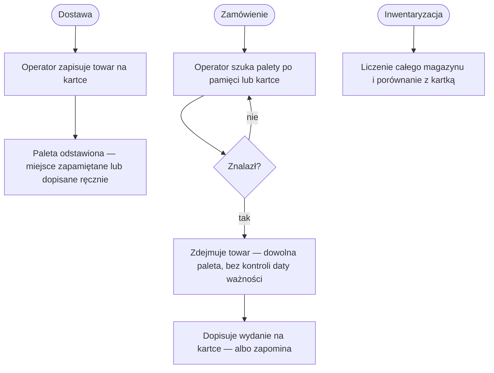
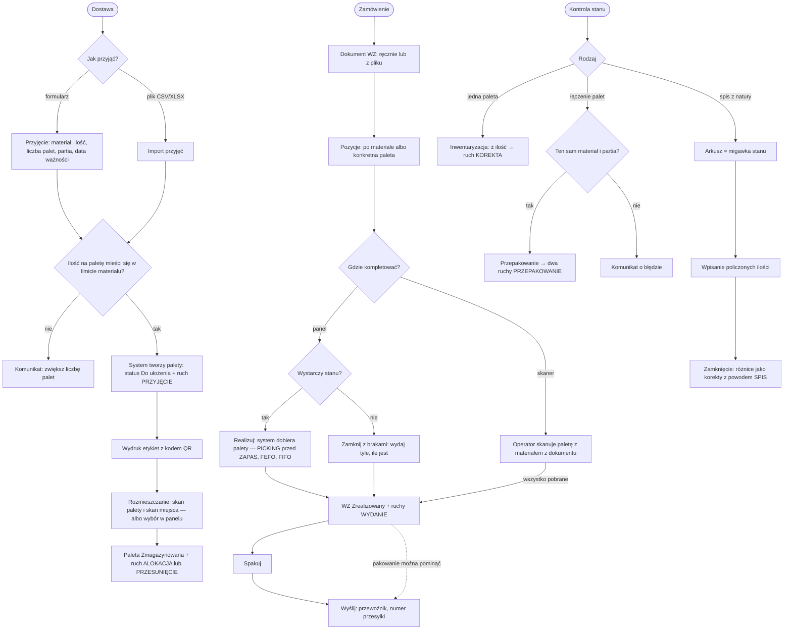

# 02. Proces biznesowy

## Aktorzy

| Aktor | Rola w procesie |
|---|---|
| **Operator** | przyjmuje towar, rozmieszcza palety, kompletuje wydania, koryguje, przepakowuje, liczy spis |
| **Administrator** | to co operator + konta i role, dziennik logowań, termin dostawy palety |
| **Podgląd** | tylko odczyt: stany, palety, wydania, ruchy, raporty |
| **System** | nadaje numery palet i dokumentów, dobiera palety FEFO → FIFO, zapisuje każdy ruch |

## PRZED — ewidencja na papierze

Słabe punkty: brak etykiet (C, E), pętla szukania (F), brak reguły wydania (G), brak
historii (H), inwentaryzacja bez punktu odniesienia (J).

## PO — z aplikacją

## Punkty decyzyjne

| Punkt | Reguła | Gdzie |
|---|---|---|
| Limit na paletę | ilość na jednej palecie ≤ limit materiału (jeśli ustawiony) | `services.py:114` |
| Miejsce na regale | pojemność jest informacyjna — przekroczenie nie blokuje odłożenia, system pokazuje ostrzeżenie | `services.allocate_hu`, `location_over_capacity` |
| Dostępność stanu | wydanie po materiale wymaga pełnej dostępnej ilości; tryb „z brakami” wydaje, ile jest | `services.py:381`, `services.py:407` |
| Dobór palet | PICKING przed ZAPAS → najkrótsza data ważności → najstarsze przyjęcie | `services.py:305` |
| Wydanie z rampy | gdy na regałach brakuje, system bierze też palety „Do ułożenia” (bez lokalizacji) — na końcu kolejki | `services.py:315` |
| Łączenie palet | ten sam materiał, zgodna partia, cel niepusty | `services.py:251-269` |
| Spis | różnica policzone ≠ stan → korekta | `services.py:560` |
| Korekta pustej palety | korekta z 0 na więcej przywraca paletę do statusu „Do ułożenia” (bez lokalizacji) | `services.py:212` |

## Założenia procesu

- **Na czas spisu z natury magazyn jest zamrożony** — zamknięcie arkusza porównuje
  policzoną ilość z bieżącym stanem palety.
- **Wysyłka bez pakowania jest dozwolona** — pakowanie to opcjonalny krok.
- **Zwrotów nie ma** — proces kończy się na wysyłce.
