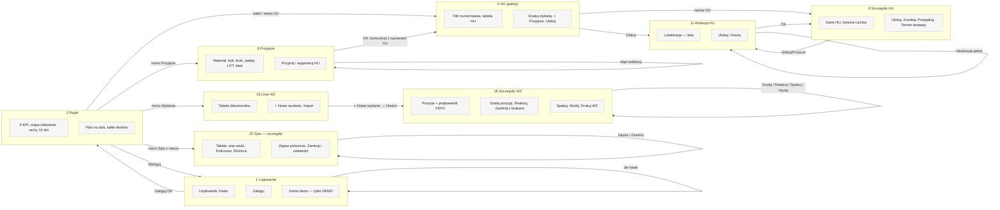
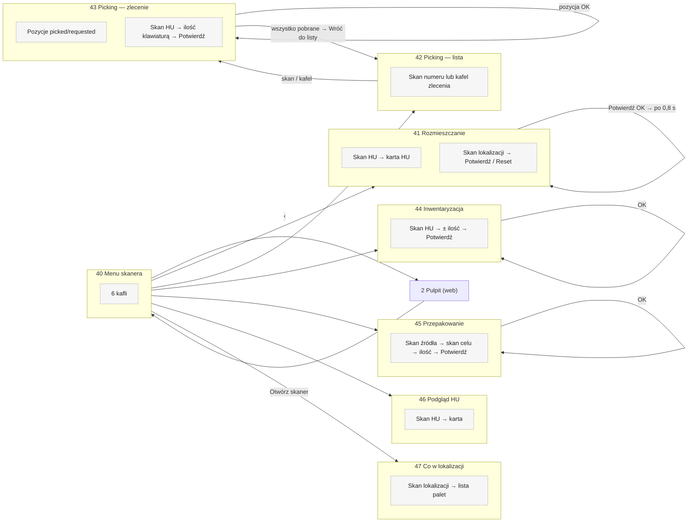

# 03. User flow — mapa ekranów i przejść

Numeracja ekranów: 1–35 panel w przeglądarce, 40–47 skaner (telefon lub kolektor).
Diagramy pokazują rdzeń przejść; pełna lista jest w tabelach.

## Panel web

| Nr | Ekran (URL) | Rola | Elementy | Akcja użytkownika | Prowadzi do |
|---|---|---|---|---|---|
| 1 | Logowanie `/login/` | gość | Użytkownik, Hasło, Zaloguj; w DEMO: konta demo | Zaloguj | OK → 2 (lub `next`); błąd → 1 „Niepoprawny login lub hasło.”; DEMO >10 prób/5 min → 429 tekst |
| 2 | Pulpit `/` | wszyscy | 6 KPI, obłożenie lokalizacji, ruchy 14 dni, realizacja wydań, plan na dziś, kafle, top 10 materiałów, ostatnie ruchy | kafel / menu / pozycja planu | odpowiedni ekran |
| 3 | Materiały `/materialy/` | wszyscy | szukaj, tabela, „+ Nowy materiał” (operator) | Szukaj / + Nowy | 3 / 4 |
| 4 | Nowy materiał | operator | indeks, nazwa, jednostka, maks./paletę | Zapisz / Anuluj | 3 „Dodano materiał” / poprzednia strona |
| 5 | HU `/hu/` | wszyscy | filtr numer/status, tabela, Drukuj etykiety, + Przyjęcie, Ulokuj | numer HU / Ulokuj / Drukuj | 6 / 11 / PDF |
| 6 | HU — szczegóły | wszyscy | dane HU, historia (50); operator: Ulokuj, Korekta, Przepakuj; admin: Termin dostawy | przyciski | 11 / 12 / 15 / 13 / PDF |
| 7 | Lokalizacje | wszyscy | tabela, etykiety; operator: Import, + Nowa | | 8 / 10 / PDF |
| 8 | Nowa lokalizacja | operator | kod, typ, pojemność | Zapisz | 7 |
| 9 | Przyjęcie `/przyjecie/` | operator | materiał, tryb (całkowita / na paletę), ilości, palety, LOT, data ważności, nr dostawy; brak „Anuluj” | Przyjmij | OK → 5 z numerami HU; walidacja/limit → 9 |
| 10 | Import lokalizacji / przyjęć / zleceń / stanów | operator | plik CSV/XLSX (≤5 MB) | Importuj | lista (7 / 5 / 16 / 26) z podsumowaniem i ostrzeżeniami — także przy błędzie |
| 11 | Alokacja HU | operator | lokalizacja (lista) | Ulokuj / Anuluj | 6; pełna → 11 z błędem; pusty HU → 6 z błędem |
| 12 | Korekta ilości HU | operator | nowa ilość ≥0, uwaga | Zapisz korektę | 6 |
| 13 | Termin dostawy HU | admin | data, nr dostawy | Zapisz | 6 |
| 14 | Inwentaryzacja `/inwentaryzacja/` | operator | nr HU, Dodaj/Odejmij, ilość, powód, uwaga, ostatnie korekty | Zapisz zmianę | 14 z komunikatem; nieznany HU / stan <0 → błąd pola |
| 15 | Przepakowanie | operator | HU źródłowy, docelowy, ilość, ostatnie przepakowania | Przepakuj | 15 |
| 16 | Wydania `/wydania/` | wszyscy | tabela WZ; operator: Import, + Nowe | | 18 / 17 / 10 |
| 17 | Nowe wydanie | operator | referencja | Utwórz | 18 |
| 18 | WZ — szczegóły | wszyscy | pozycje z podpowiedzią FEFO, ruchy, Drukuj WZ; operator: Dodaj pozycję, Usuń, Realizuj, Zamknij z brakami, Spakuj, Wyślij | każda akcja | 18 z komunikatem (dane formularza przepadają przy błędzie) |
| 19 | Spis z natury `/spis/` | wszyscy | lista arkuszy; operator: nowy arkusz (zakres) | Utwórz arkusz | 22 |
| 22 | Spis — szczegóły | wszyscy | tabela z polem „Policzono” (operator, otwarty) | Zapisz / Zamknij | 22 |
| 26 | Stany `/stany/` | wszyscy | tabela wg materiału, CSV, Excel; operator: Import | Wg lokalizacji / eksport | 27 / plik |
| 27 | Stan wg lokalizacji | wszyscy | szukaj, tabela | HU | 6 |
| 28 | Ruchy `/ruchy/` | wszyscy | filtr typu, CSV, Excel, ostatnie 500 | | plik |
| 29 | Raporty | wszyscy | 4 karty | | 30 / 31 / 27 / 28 |
| 30 | Zajętość lokalizacji | wszyscy | KPI, tabela z zapełnieniem | kod | 27 |
| 31 | Kartoteka materiału | wszyscy | wybór materiału, stan, historia (500) | | 31 |
| 32 | Użytkownicy | admin | tabela, mapa uprawnień, Dziennik, + Nowy | | 33 / 34 / 35 |
| 33 | Nowy użytkownik | admin | login, e-mail, hasło, rola | Utwórz | 32 |
| 34 | Edycja użytkownika | admin | rola, aktywne, nowe hasło | Zapisz | 32; własne konto → błąd; konto demo → 403 tekst |
| 35 | Dziennik logowań | admin | tabela, stronicowanie 100 | | 32 |

## Skaner

| Nr | Ekran | Elementy | Akcja | Prowadzi do / wynik |
|---|---|---|---|---|
| 40 | Menu skanera `/skaner/` | 6 kafli, „‹” | kafel / ‹ | 41–47 / Pulpit web |
| 41 | Rozmieszczanie | pole skanu, karta HU, karta lokalizacji, Potwierdź, Reset | skan HU → skan lokalizacji → Potwierdź | baner „✓ HU → LOC”, reset; błędy: nieznany HU/lokalizacja, pusty HU, pełna lokalizacja |
| 42 | Picking — lista | pole numeru, kafle otwartych WZ | skan / kafel | 43; nieznany numer → błąd |
| 43 | Picking — zlecenie | pozycje, skan HU, klawiatura, Potwierdź, „Wróć do listy” | skan HU → ilość → Potwierdź | pozycja odhaczona; komplet → WZ Zrealizowany → „Wróć do listy”; błędy: materiał spoza WZ, za dużo, brak stanu |
| 44 | Inwentaryzacja | skan HU, ±, ilość, „stan po zmianie”, Potwierdź | | ruch KOREKTA; błąd przy wyniku <0 |
| 45 | Przepakowanie | skan źródła, celu, ilość, „Cała paleta” | | 2 ruchy; błędy: ten sam HU, inny materiał, pusty cel, inny LOT (dopiero po Potwierdź) |
| 46 | Podgląd HU | skan HU, karta | | tylko odczyt |
| 47 | Co w lokalizacji | skan lokalizacji, lista palet | | tylko odczyt |

## Ścieżki alternatywne
- **Gość** → każdy adres przekierowuje na 1 i po zalogowaniu wraca (`next`).
- **Rola Podgląd** → menu bez operacji; wejście na adres operatora = domyślna strona 403 Django
  bez menu (`roles.py:37`).
- **Modal vs strona** — brak modali; potwierdzenia przez `confirm()` przeglądarki (usuń pozycję,
  realizuj, zamknij z brakami, zamknij spis).
- **Błąd walidacji** — formularze na osobnych stronach: ta sama strona z błędami pól; formularze
  wbudowane w szczegóły WZ i spisu: komunikat nad stroną, wpisane wartości przepadają.
- **Przerwanie procesu** — skaner: „Reset” lub „‹” bez potwierdzenia; web: „Anuluj” (brak na
  ekranie 9).

## Ścieżki ślepe (znane problemy)
1. Strona 403 bez nawigacji (każdy ekran operatora/admina dla złej roli).
2. Kafel „Import wydań” (D02) widoczny dla roli Podgląd → 403 (`dashboard.html:134`).
3. „Administracja” w menu i kafel A03 w trybie DEMO → 404 (`config/urls.py:41`).
4. Ekrany 6, 18, 22 bez linku powrotu do listy; ekran 9 bez „Anuluj”.
5. Skaner — wygasła sesja pokazuje „Błąd serwera (200).” zamiast logowania (`scanner.js:47-51`).
6. Skaner — pusty skan: brak reakcji; błąd wczytania zlecenia: pusta lista bez komunikatu
   (`picking_doc.html:93-95`).
7. Endpointy tylko-POST wywołane GET-em — ciche przekierowanie bez komunikatu.
8. Spis: wartości nie-liczbowe w „Policzono” pomijane bez informacji (`views.py:1009`).
9. „Administracja” dla roli Administrator bez konta superusera → logowanie panelu Django
   odrzuca konto (brak `is_staff`, `views.py:1220`).
10. Skaner — kompletacja: przy pozycji z „konkretnym HU” skaner przyjmuje dowolną paletę tego
    materiału, bez ostrzeżenia (`scanner_views.py:284-291`).
