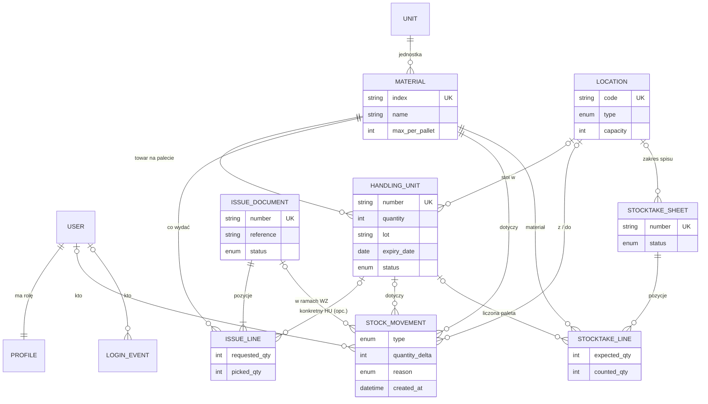

# 04. Model danych

Podstawowa jednostka stanu to **paleta (HU)** — każda ma własny materiał, ilość, partię,
datę ważności, status i lokalizację. Każda zmiana stanu zapisuje **ruch** w tej samej
transakcji, więc historia zawsze zgadza się ze stanem.

## Encje

| Encja | Klucz / unikalność | Atrybuty (typ, wymagalność) | Uwagi |
|---|---|---|---|
| **User** (Django) | id; `username` unikalny | username, email, password, is_active, is_superuser | wbudowany |
| **Profile** | id; `user` 1:1 | role ∈ {ADMIN, OPERATOR, VIEWER}, domyślnie VIEWER | tworzony sygnałem po zapisie User (`signals.py:15-27`) |
| **Unit** | `code` unikalny (10) | name (50, opcjonalna) | domyślnie `PCS` z migracji `0002` |
| **Material** | `index` unikalny (40) | name (200, wym.), unit FK, max_per_pallet (int ≥1 lub NULL), created_at, created_by | CHECK `max_per_pallet IS NULL OR ≥1` (`models.py:90`) |
| **Location** | `code` unikalny (40) | type ∈ {PICKING, ZAPAS} (dom. ZAPAS), capacity (int ≥0, dom. 1; 0 = bez limitu), created_at | `occupancy` liczone, nie zapisane |
| **HUNumberingConfig** | id | prefix (dom. „HU”), next_number, padding (dom. 8) | logicznie jeden wiersz (singleton) |
| **HandlingUnit (HU)** | `number` unikalny (30) | material FK (wym.), quantity (int ≥0), lot, expiry_date, status ∈ {DO_ULOZENIA, ZMAGAZYNOWANY, PUSTY}, location FK (opc.), delivery_ref, delivery_date, created_at, created_by | CHECK `quantity ≥ 0` (`models.py:216`); indeksy: status, (material, status) |
| **IssueDocument (WZ)** | `number` unikalny (30) | reference, status ∈ {OTWARTY, ZREALIZOWANY, SPAKOWANY, WYSLANY}, created_at/by, completed_at, packed_at, shipped_at, carrier, tracking_number | numer `WZ<RRRRMMDD>-NNN` |
| **IssueLine** | id | document FK, material FK, requested_qty (≥1), picked_qty (dom. 0), specific_hu FK (opc.) | `outstanding`, `shortage` liczone |
| **StockMovement** | id | type ∈ {PRZYJECIE, ALOKACJA, PRZESUNIECIE, KOREKTA, WYDANIE, PRZEPAKOWANIE}, handling_unit FK (opc.), material FK, quantity_delta (±int), location_from/to (opc.), issue_document (opc.), reason ∈ AdjustReason (opc.), note, created_at, created_by | rejestr audytowy (tylko dopisywanie) |
| **StocktakeSheet** | `number` unikalny | location FK (opc. = cały magazyn), status ∈ {OTWARTY, ZAMKNIETY}, created_at/by, closed_at | numer `SP<RRRRMMDD>-NNN` |
| **StocktakeLine** | UNIQUE (sheet, handling_unit) | sheet FK, handling_unit FK (opc.), material FK, location_code (tekst — migawka), expected_qty (int), counted_qty (int, opc.) | `variance` liczone |
| **LoginEvent** | id | user FK (opc.), username, kind ∈ {LOGIN, LOGOUT, FAILED}, ip, user_agent, created_at | dziennik logowań |
| **AuditEvent** | id | created_at (indeks), actor FK (opc.) + actor_username, target FK (opc.) + target_username, action ∈ {USER_CREATE, ROLE_CHANGE, PASSWORD_CHANGE, ACTIVE_CHANGE, 2FA_ENABLE, 2FA_RESET, USER_DELETE, ACCESS_DENIED}, result ∈ {OK, DENIED}, detail | dziennik audytowy (US-022, ADR-0008) |

## Diagram

Usuwanie: materiał i jednostka są chronione (`PROTECT`) — nie da się usunąć materiału z historią.
Usunięcie HU/lokalizacji zostawia ruchy z pustym odwołaniem (`SET_NULL`). Usunięcie WZ kasuje
pozycje (`CASCADE`). Usuwanie jest możliwe tylko w panelu admina Django — aplikacja nie ma
ekranów usuwania (poza pozycją WZ).

## Reguły integralności

**Pilnowane przez bazę:** unikalne numery palet, dokumentów i arkuszy, unikalny kod
lokalizacji i indeks materiału, ilość na palecie ≥ 0, limit na paletę ≥ 1 (jeśli podany),
jedna pozycja spisu na paletę w arkuszu, ochrona materiału z historią przed usunięciem.

**Pilnowane tylko przez kod aplikacji** (luki modelu — obserwacje, nie zadania):
1. **Status HU nie jest powiązany z ilością i lokalizacją w bazie.** Reguła „PUSTY ⇔ ilość 0,
   bez lokalizacji” i „ZMAGAZYNOWANY ⇒ ma lokalizację” żyje tylko w `services.py:231-235`.
   Import stanów tworzy HU z ilością 0 i statusem ZMAGAZYNOWANY — celowo, z ostrzeżeniem
   w podsumowaniu importu ([D-09](06-decyzje.md#d-09-import-stanów-z-ilością-0-zostaje--z-ostrzeżeniem)).
2. **Pojemność 0 ma dwa znaczenia:** w alokacji „bez limitu” (`services.py:160`), w raporcie
   zajętości „pełna” (`report_locations.html:24`).
3. **Unikalność numerów rozróżnia wielkość liter w bazie**, a aplikacja szuka bez
   rozróżniania (importy, skaner, ekrany — [D-10](06-decyzje.md#d-10-numery-palet-bez-rozróżniania-wielkości-liter));
   importy nie tworzą palety różniącej się od istniejącej tylko wielkością liter.
4. **Pozycja WZ z konkretnym HU** — zgodność materiału HU z materiałem pozycji pilnowana tylko
   w formularzu i przy realizacji (`services.py:421-426`), nie w bazie.
5. **`picked_qty ≤ requested_qty`** — brak ograniczenia; pilnuje skaner (`scanner_views.py:300`)
   i realizacja (liczy `outstanding`).
6. **Status WZ a daty** (`completed_at`, `packed_at`, `shipped_at`) — brak ograniczenia, że
   ZREALIZOWANY ma `completed_at`.
7. **Konfiguracja numeracji HU** — „jeden wiersz” nie jest wymuszony; kod bierze pierwszy
   (`services.py:62`).
8. **Spis: `expected_qty`/`counted_qty` dopuszczają liczby ujemne** w bazie; ekran przycina do 0
   (`views.py:1009`).
9. **Lokalizacja w pozycji spisu to tekst** (migawka), nie FK — świadomie, ale bez komentarza.
10. **Pojemność lokalizacji** — 0 = „bez limitu” w formularzu i w imporcie; wartości ujemne
    odrzuca formularz i import, w bazie brak dodatkowego ograniczenia (`PositiveIntegerField`).
11. **Suma pozycji WZ wskazujących ten sam HU** — pilnowana przy dodawaniu pozycji
    (`views.issue_add_line`), nie w bazie.
12. **Jedna paleta w wielu otwartych arkuszach spisu** — `UNIQUE (sheet, handling_unit)`
    obejmuje tylko jeden arkusz (`models.py:491`).
