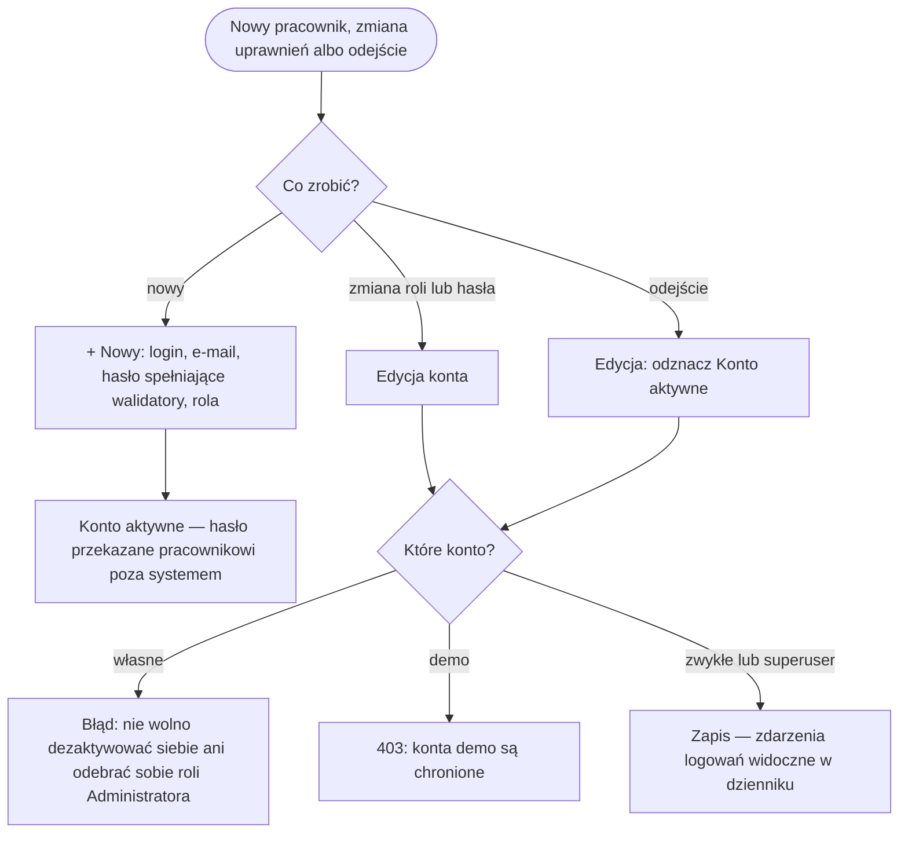
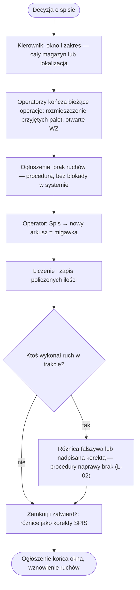
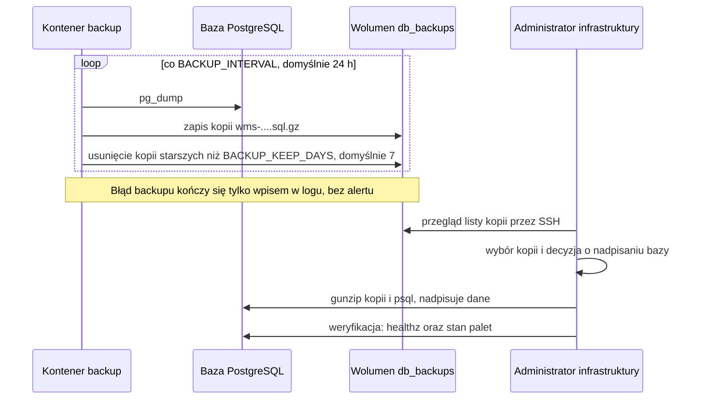
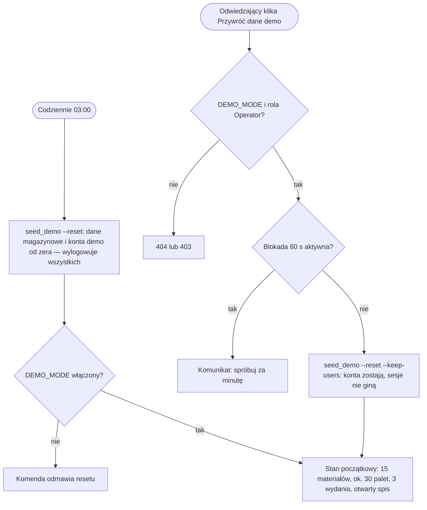
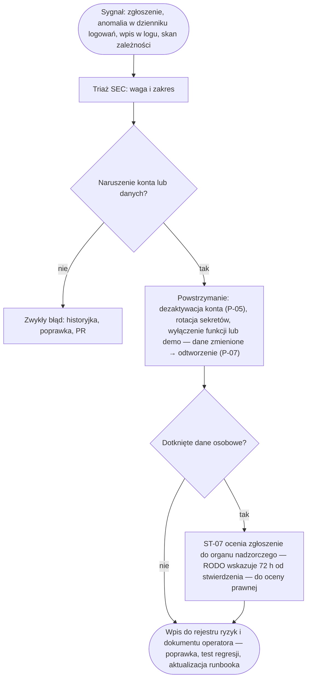

# Procesy — miniWMS

| | |
|---|---|
| Wersja | 0.1 |
| Data | 2026-10-16 |
| Status | szkic — do akceptacji Product Ownera |
| Właściciel | [BA] |

Procesy magazynowe są opisane w [docs/02](../02-proces.md) (PRZED/PO, punkty decyzyjne) i [docs/03](../03-user-flow.md)
(ekrany) — tu tylko im **nadajemy identyfikatory** (P-01…P-04) i dopisujemy procesy administracyjne, których brakowało
([audyt §1.2](../AUDYT.md)): P-05…P-09. Role: [SLOWNIK.md](SLOWNIK.md), interesariusze (ST-xx): [INTERESARIUSZE.md](INTERESARIUSZE.md).

## 1. Rejestr procesów

| ID | Proces | Aktor główny | Gdzie opisany |
|---|---|---|---|
| P-01 | Przyjęcie dostawy (formularz lub import, etykiety QR) | Operator | [docs/02 — PO](../02-proces.md#po--z-aplikacją), węzły A–F; ekrany 9–10; W-01…W-05 |
| P-02 | Rozmieszczanie palet (panel lub skaner) | Operator | docs/02, węzły G–I; ekrany 11, 41; W-06…W-09 |
| P-03 | Wydanie: WZ, dobór FEFO → FIFO, pakowanie, wysyłka | Operator | docs/02, węzły J–S; ekrany 16–18, 42–43; W-10…W-17, W-25 |
| P-04 | Kontrola stanu: korekta, przepakowanie, spis z natury | Operator | docs/02, węzły T–Z; ekrany 14–15, 19, 22, 44–45; W-18…W-20, W-26 |
| P-05 | Zakładanie i dezaktywacja kont | Administrator | sekcja 2 |
| P-06 | Zamrożenie magazynu na spis | Kierownik + Operatorzy | sekcja 3 (uzupełnia P-04) |
| P-07 | Backup i odtworzenie bazy | Administrator infrastruktury | sekcja 4 |
| P-08 | Reset danych demo | Harmonogram / odwiedzający | sekcja 5 |
| P-09 | Obsługa incydentu bezpieczeństwa (szkic) | SEC + PO | sekcja 6 |

Punkty decyzyjne i reguły P-01…P-04: [docs/02 — Punkty decyzyjne](../02-proces.md#punkty-decyzyjne).

## 2. P-05 Zakładanie i dezaktywacja kont

**Aktorzy:** Administrator (ST-03), nowy użytkownik, System. **Ekrany:** `/uzytkownicy/`, `/uzytkownicy/nowy/`,
`/uzytkownicy/<pk>/`, dziennik `/uzytkownicy/dziennik/` (docs/03, ekrany 32–35).

- **Punkty decyzyjne:** rola (Operator, Podgląd, Administrator); dezaktywacja zamiast usunięcia — widoki aplikacji nie
  usuwają kont, więc historia ruchów (`created_by`) zostaje.
- **Wyjątki i uwagi:** formularz nowego konta podpowiada rolę Operator (`forms.py:141`), choć brak profilu daje Podgląd —
  zasada najmniejszych uprawnień do potwierdzenia. Hasło ustawia i zna Administrator; użytkownik nie ma ścieżki
  zmiany ani odzyskania hasła (L-01). Administrator może dziś edytować superusera (R1, pierwsza historyjka wg Z-07).
  Zachowanie już otwartej sesji po dezaktywacji — do potwierdzenia testem [DEV].

## 3. P-06 Zamrożenie magazynu na spis

**Aktorzy:** Kierownik (ST-02) ogłasza okno; Operatorzy kończą operacje, liczą i zamykają arkusz; System robi migawkę
i nanosi korekty. **Podstawa:** [D-07](../06-decyzje.md#d-07-spis-z-natury-przy-zamrożonym-magazynie). Aplikacja zamrożenia
**nie wymusza**: arkusz to migawka, a zamknięcie porównuje policzone z *bieżącym* stanem palety i koryguje różnicę
(powód SPIS) — żadna operacja nie jest blokowana przy otwartym arkuszu.

- **Punkty decyzyjne:** zakres arkusza; kto zatwierdza zamknięcie (dziś Operator — pytanie 1); pozycje bez wpisu
  „Policzono” są pomijane z ostrzeżeniem.
- **Wyjątki:** paleta z otwartego arkusza jest pomijana w nowym ([D-13](../06-decyzje.md)); dwa arkusze założone
  w tej samej chwili mogą objąć tę samą paletę ([docs/07](../07-ograniczenia.md), znany problem 2).

## 4. P-07 Backup i odtworzenie bazy

**Aktorzy:** kontener `backup` (System), Administrator infrastruktury (ST-05). **Źródło:** [COOLIFY.md §10](../../COOLIFY.md).

- **Punkty decyzyjne:** którą kopię odtworzyć; czy nadpisać produkcję (komenda niszczy bieżące dane).
- **Parametry wynikające z konfiguracji:** RPO ≤ interwał backupu (domyślnie 24 h); RTO nieokreślone.
- **Wyjątki:** kopia leży na tym samym hoście co baza — awaria dysku niszczy oba, nic nie jest szyfrowane ani wysyłane
  poza serwer, odtworzenie nieprzećwiczone (R9, L-03). COOLIFY.md nie mówi, czy na czas odtworzenia zatrzymać aplikację.

## 5. P-08 Reset danych demo

**Aktorzy:** harmonogram (Scheduled Task), odwiedzający demo (ST-09, rola Operator), System.
**Źródło:** [COOLIFY.md §11](../../COOLIFY.md), `warehouse/demo.py`, `docs/pitfalls/auth.md` #13.

- **Wyjątki:** blokada 60 s jest w pamięci procesu (3 workery → do 3 resetów na minutę); reset w żądaniu HTTP z
  `LOCK TABLE` na PostgreSQL (R5). Niedostępność demo to ryzyko wizerunkowe, nie utrata danych (Z-05).

## 6. P-09 Obsługa incydentu bezpieczeństwa (szkic)

**Aktorzy:** wykrywający (każdy), SEC — triaż, PO — decyzje o wyłączeniu funkcji lub demo, ST-05 — sekrety i
odtworzenie, ST-07 — ocena obowiązków wobec organu nadzorczego. Szczegóły techniczne trafią do `operacje/RUNBOOK.md` (planowany).

- **Wyjątki:** alertów o błędach 500 nie ma (T15), więc wykrycie zależy od człowieka; w chwili audytu brak `SECURITY.md` —
  zewnętrzny zgłaszający nie miał kanału (L-06). W demo dane są fikcyjne, więc incydent to głównie dostępność i wizerunek.

## 7. Luki procesowe

| ID | Luka | Źródło | Proces |
|---|---|---|---|
| L-01 | Użytkownik nie może sam zmienić ani odzyskać hasła; ustawia je Administrator, który je zna | brak tras zmiany/resetu hasła w `config/urls.py`, `warehouse/urls.py` | P-05 |
| L-02 | Zamrożenie na spis to tylko założenie: brak blokady, sygnału w UI i procedury naprawy rozbieżności | D-07; `services.create_stocktake`, `close_stocktake` | P-06 |
| L-03 | Backup lokalny, nieszyfrowany, bez testu odtworzenia, alertu i zdefiniowanego RTO | [audyt R9](../AUDYT.md) | P-07 |
| L-04 | Brak alertów o błędach 500 i monitoringu dostępności | [audyt T15](../AUDYT.md) | P-08, P-09 |
| L-05 | Brak procedury praw osób i retencji `LoginEvent` | [audyt R7](../AUDYT.md), Z-09 | P-05, P-09 |
| L-06 | Brak `SECURITY.md` i runbooka incydentów | [audyt §1.2](../AUDYT.md) | P-09 |
| L-07 | Skaner: błąd wczytania zlecenia bez komunikatu; endpointy tylko-POST wywołane GET-em przekierowują bez informacji | [docs/03 — ścieżki ślepe](../03-user-flow.md#ścieżki-ślepe-znane-problemy) | P-03 |
| L-08 | Pomyłkowo zrealizowanego WZ nie da się anulować (poza zakresem); naprawa zostaje korektą ilości — wniosek BA | [docs/01](../01-problem-i-zakres.md#poza-zakresem--i-dlaczego) | P-03 |
| L-09 | Procesy P-02/P-03 nie były walidowane z użytkownikami (telefon, rękawice, hala) | [audyt §1.3 pkt 7](../AUDYT.md) | P-02, P-03 |

## Otwarte pytania (do PO)

1. Czy ma powstać techniczna blokada ruchów przy otwartym arkuszu i czy zamknięcie spisu wymaga zatwierdzenia
   kierownika? (oba to nowe wymagania — dziś tylko założenie D-07)
2. Czy użytkownik ma móc sam zmienić lub odzyskać hasło (wpływa na e-mail i RODO)? Czy domyślna rola nowego konta
   ma być Podgląd zamiast Operatora?
3. Ile pracy wolno utracić (RPO) i w jakim czasie odtworzyć system (RTO) — osobno dla produkcji i demo?
4. Kto i kiedy wykonuje pierwszy test odtworzenia z kopii?
5. Czy w razie incydentu na demo PO zezwala na natychmiastowe wyłączenie demo bez konsultacji?
