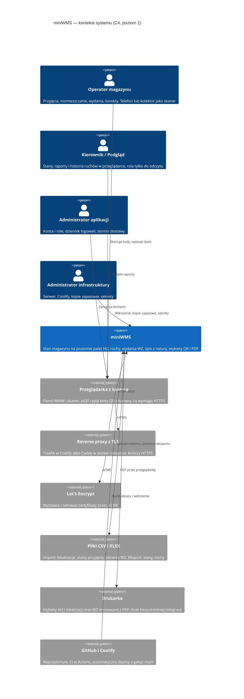
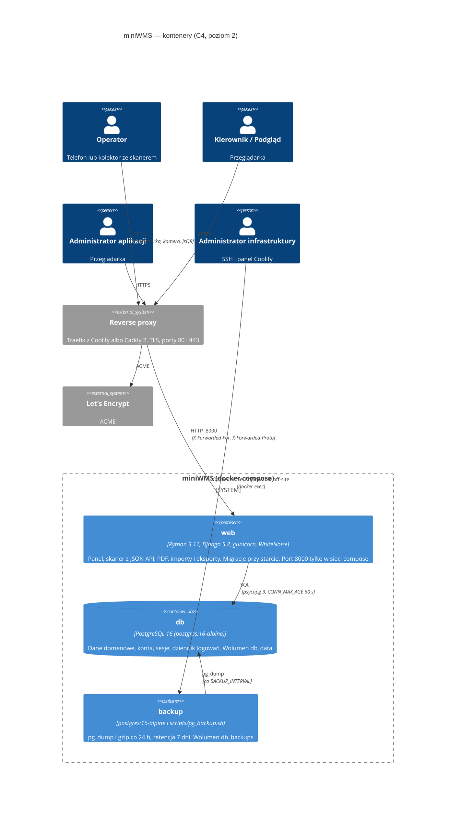
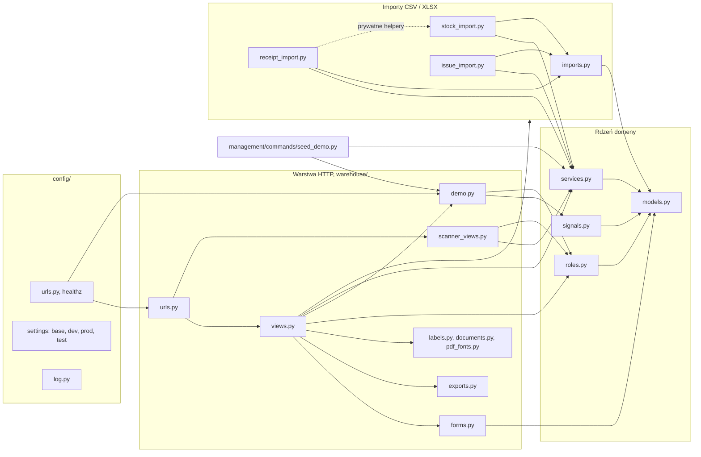
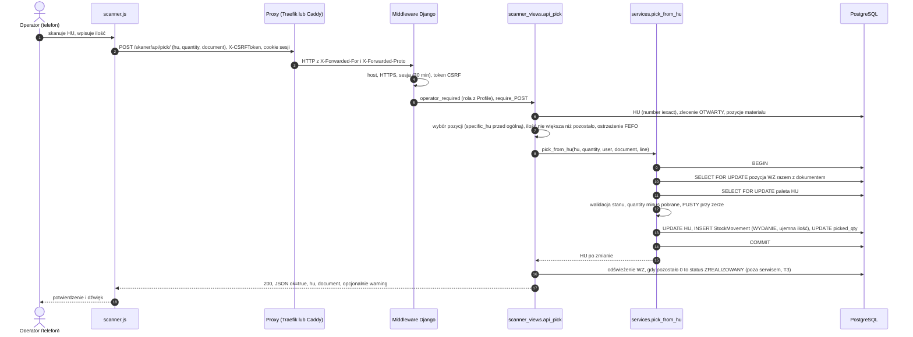
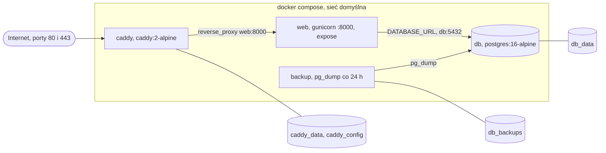
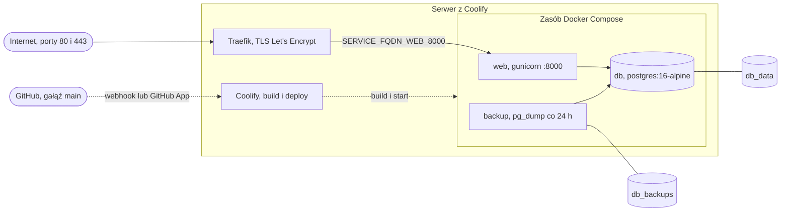

# Architektura miniWMS

| | |
|---|---|
| Wersja | 0.1 |
| Data | 2026-10-16 |
| Status | szkic — do akceptacji Product Ownera |
| Właściciel | [DEV] |

Opis architektury w modelu C4 (poziomy 1–3), przepływu żądania, środowisk, wdrożenia i
znanego długu architektonicznego. Dokument **uzupełnia**, nie powtarza: model danych jest w
[docs/04](../04-model-danych.md), decyzje historyczne w [docs/06](../06-decyzje.md), instrukcja
wdrożenia w [docs/wdrozenie.md](../wdrozenie.md) i [COOLIFY.md](../../COOLIFY.md) (Z-03).
Fakty pochodzą z kodu i konfiguracji repozytorium (stan `main` + drzewo robocze z 2026-10-16);
czego w repo nie ma (parametry serwera, monitoring), oznaczono „do uzupełnienia przez
administratora infrastruktury / PO”.

| Dokument powiązany | Do czego |
|---|---|
| [MODEL_DANYCH.md](MODEL_DANYCH.md) | zasady zmian modelu, zmiany planowane |
| [API.md](API.md) | JSON API skanera, healthz, eksporty, PDF |
| [adr/README.md](adr/README.md) | indeks decyzji architektonicznych (ADR-0001…, ADR-H-01…13) |
| [../testy/STRATEGIA_TESTOW.md](../testy/STRATEGIA_TESTOW.md) | jak i gdzie testujemy |
| [../operacje/RUNBOOK.md](../operacje/RUNBOOK.md) | deploy, backup, incydenty |
| [../AUDYT.md](../AUDYT.md) | źródło oznaczeń T1–T16 (dług) i R1–R10 (ryzyka) |
| [../pitfalls/](../pitfalls/db.md) | pułapki per obszar (db, auth, views, deploy) |

---

## 1. Kluczowe właściwości

| Właściwość | Jak jest zrealizowana | Gdzie | Uwagi |
|---|---|---|---|
| **Jedna warstwa usług** (D-05) | każda zmiana stanu to funkcja z `@transaction.atomic`, która zapisuje też `StockMovement`; widoki, skaner, importy i `seed_demo` wołają te same funkcje | `warehouse/services.py` | wyjątek: zamknięcie WZ w `api_pick` (T3, sekcja 8) |
| **Transakcje i blokady wierszy** | `select_for_update` na palecie, pozycji WZ i liczniku HU; blokady zawsze w ustalonej kolejności (pozycja WZ → HU; przepakowanie wg `pk`), by uniknąć zakleszczeń | `services.py` (`_lock_and_sync`, `pick_from_hu`, `repack_hu`, `generate_hu_number`) | na SQLite blokady nic nie robią — wyścigi sprawdza job `test-postgres` ([db.md #2](../pitfalls/db.md)) |
| **Reguły w bazie** | `CheckConstraint` (ilość HU ≥ 0, limit na paletę ≥ 1), unikalne numery/kody/indeksy, `UniqueConstraint (arkusz, HU)` w spisie, `PROTECT` na materiale i jednostce | `warehouse/models.py` | luki: [docs/04 „Reguły integralności”](../04-model-danych.md#reguły-integralności) |
| **Role z `Profile`** | 3 role (Podgląd, Operator, Administrator); superuser = Administrator; nowe konto = Podgląd (sygnał `post_save`); dekoratory `login_required` / `operator_required` / `admin_required` na każdym widoku | `roles.py`, `signals.py` | brak separacji danych między użytkownikami — jeden magazyn (Z-06, [auth.md #4](../pitfalls/auth.md)) |
| **Tryb demo (`DEMO_MODE`)** | baner, konta demo, „Wejdź jako demo”, `/demo/`, reset danych, limit importu 500 wierszy, wyłączony `/admin/` | `demo.py`, `config/urls.py`, `seed_demo` | świadome wyjątki od zasad bezpieczeństwa: R5, Z-05 |
| **Ustawienia dev / prod** | `config/settings/__init__.py` wybiera nakładkę po `DJANGO_DEBUG`; brak zmiennej = **dev**; `prod.py` odmawia startu z kluczem `django-insecure-…` | `config/settings/` | luka R2: zaślepki kluczy inne niż `django-insecure-` przechodzą |
| **Pliki statyczne bez osobnego serwera** | WhiteNoise w middleware; `collectstatic` w trakcie budowy obrazu; w prod manifest + kompresja | `base.py`, `prod.py`, `Dockerfile` | — |
| **Serwer aplikacji** | gunicorn, domyślnie 3 workery synchroniczne (`GUNICORN_WORKERS`), `--timeout 120`, logi na stdout | `entrypoint.sh` | żądanie dłuższe niż 120 s kończy się zabiciem workera (R3, R4) |
| **Cache** | brak `CACHES` → LocMem, osobny **dla każdego procesu** | `demo.py` (limit logowań, blokada resetu) | T8 — limit logowań realnie ×liczba workerów |
| **Sesje** | w bazie (`django.contrib.sessions`), 30 min bezczynności, zapis przy każdym żądaniu, `HttpOnly`, `SameSite=Lax`, `Secure` w prod | `base.py` | brak `clearsessions` w harmonogramie (R5) |
| **Dziennik logowań** | sygnały Django zapisują `LoginEvent` (udane, wylogowania, nieudane; IP, user-agent) | `signals.py`, `models.LoginEvent` | IP tylko od zaufanego proxy (D-12); brak retencji (R7) |
| **Logi** | stdout; w prod JSON (`ts, level, logger, msg, exc`), w dev tekst; gunicorn dopisuje access log (tekst) | `config/log.py`, `base.py` | brak alertów na błędy 500 (T15) |
| **Numeracja** | HU: licznik `HUNumberingConfig` pod blokadą; WZ/SP: `PREFIX<data>-NNN` liczone bez blokady, zapis z ponowieniem po kolizji (D-03) | `services.py` | [db.md #4](../pitfalls/db.md) |
| **Migracje przy starcie** | `entrypoint.sh`: czeka na bazę → `migrate --noinput` → zakłada superusera z env → gunicorn | `entrypoint.sh` | migracja, która się wywali, zatrzyma start ([deploy.md #2](../pitfalls/deploy.md)) |
| **PDF i QR w procesie żądania** | ReportLab + `qrcode`, czcionki DejaVu; generowane synchronicznie | `labels.py`, `documents.py` | brak kolejki zadań; limity: 200 etykiet HU (D-11), etykiet lokalizacji brak (R5) |
| **Frontend bez bundlera** | szablony Django, własny CSS i JS, `jsQR` w `static/warehouse/vendor/` | `warehouse/templates`, `static` | — |
| **Interfejs po polsku** | `LANGUAGE_CODE=pl`, strefa `Europe/Warsaw`, `USE_TZ=True` | `base.py` | — |

### Parametry techniczne wynikające z kodu

| Parametr | Wartość | Źródło |
|---|---|---|
| Bezczynność sesji | 1800 s (`DJANGO_SESSION_AGE`) | `base.py` |
| Limit prób logowania | 10 prób POST / 300 s na IP (po przekroczeniu: 429) | `demo.py` |
| Upload (importy) | 5 MB w formularzu; `DATA_UPLOAD_MAX_MEMORY_SIZE` 6 MB (`DJANGO_MAX_UPLOAD_BYTES`) | `forms.py`, `base.py` |
| Limit wierszy importu w demo | 500 (`DEMO_IMPORT_MAX_ROWS`); poza demo brak limitu (R4) | `base.py`, `imports.py` |
| Wydruk etykiet HU | 200 na partię (D-11) | `views.py` (`HU_LABELS_LIMIT`) |
| Lista ruchów | 500 najnowszych, bez filtra dat (T9) | `views.py` |
| Połączenia z bazą | `CONN_MAX_AGE` 60 s (`DJANGO_CONN_MAX_AGE`) | `base.py` |
| Cooldown resetu demo | 60 s (per proces) | `demo.py` |
| HSTS | 30 dni (`DJANGO_HSTS_SECONDS`), z `includeSubDomains` i flagą `preload` (preload wymaga ≥ 1 roku — R8) | `prod.py` |
| Healthcheck kontenera | co 30 s, timeout 5 s, start 40 s, 3 próby | `Dockerfile` |

---

## 2. C4, poziom 1 — kontekst systemu

| Element | Rola | Uwagi |
|---|---|---|
| Operator (2 osoby, ~200 palet — [docs/01](../01-problem-i-zakres.md)) | wykonuje operacje magazynowe | skaner = strona w przeglądarce telefonu (D-08) |
| Kierownik / Podgląd | odczyt stanów, raportów, ruchów, eksportów | rola `VIEWER` |
| Administrator aplikacji | konta, role, dziennik logowań, termin dostawy | rola `ADMIN`; superuser dodatkowo `/admin/` (poza demo) |
| Administrator infrastruktury | VPS, Coolify, backup, sekrety | **poza aplikacją**; osoba i kontakt — do uzupełnienia przez administratora infrastruktury / PO |
| Pliki CSV/XLSX | jedyna „integracja” (D-04) | brak ERP, brak API dla systemów trzecich |
| Drukarka | wydruk z przeglądarki | drukarka etykiet / format etykiety — do uzupełnienia przez PO |
| Let's Encrypt | certyfikaty dla domeny | rozmawia z proxy, nie z aplikacją |

PostgreSQL i kontener kopii zapasowej są **częścią systemu** (wdrażane razem z aplikacją) —
pokazano je na poziomie 2. Aplikacja nie wysyła e-maili (poza trybem demo, gdzie backend
pocztowy to konsola) i nie woła żadnych usług zewnętrznych w trakcie działania.

---

## 3. C4, poziom 2 — kontenery

| Kontener | Obraz / start | Port | Wolumen | Healthcheck | Zależności |
|---|---|---|---|---|---|
| `web` | `Dockerfile` (python:3.11-slim, dwa etapy, użytkownik `app`), `entrypoint.sh` | 8000 (`expose`, bez publikacji na hosta) | — | `HEALTHCHECK` w obrazie: `GET /healthz` na 127.0.0.1:8000 | `db` (healthy) |
| `db` | `postgres:16-alpine` | 5432 tylko w sieci compose | `db_data` | `pg_isready` co 5 s | — |
| `backup` | `postgres:16-alpine`, `sh /pg_backup.sh` (montowany z repo) | — | `db_backups` | brak | `db` (healthy) |
| `caddy` (tylko `docker-compose.yml`) | `caddy:2-alpine`, `Caddyfile` | 80, 443 | `caddy_data`, `caddy_config` | brak | `web` (healthy) |
| Traefik (tylko Coolify) | proxy Coolify, poza plikiem compose | 80, 443 | zarządza Coolify | — | domena z `SERVICE_FQDN_WEB_8000` |

---

## 4. C4, poziom 3 — komponenty (moduły Django)

Kierunek zależności: **widoki → serwisy → modele**; **importy → serwisy → modele**. Modele nie
importują niczego z pakietu; `services.py` importuje wyłącznie `models.py`. Liczba linii wg
stanu 2026-10-16 (orientacyjnie — dryfuje).

| Moduł | Odpowiedzialność | Zależy od | ≈ linii |
|---|---|---|---|
| `config/settings/__init__.py` | wybór nakładki po `DJANGO_DEBUG` (brak = dev) | `dev`, `prod` | 14 |
| `config/settings/base.py` | wspólna konfiguracja z env: baza (`DATABASE_URL`), sesje, upload, logi, tryb demo, zaufane proxy | — | 216 |
| `config/settings/dev.py` / `prod.py` / `test.py` | dev: DEBUG, `ALLOWED_HOSTS=*`; prod: fail-fast na kluczu, HTTPS/HSTS/cookies, manifest statyków; test: dev + hasher MD5 (tylko pytest) | `base` | 9 / 42 / 9 |
| `config/urls.py` | `healthz`, logowanie, trasy demo, wylogowanie, `/admin/` (tylko poza demo), include `warehouse.urls` | `warehouse.demo` | 50 |
| `config/log.py` | `JsonFormatter` (logi strukturalne bez zależności) | — | 33 |
| `config/wsgi.py`, `asgi.py` | punkty wejścia serwera (używany: WSGI/gunicorn) | — | 16 / 16 |
| `warehouse/models.py` | 12 modeli (10 domenowych oraz `Profile` i `LoginEvent`); constrainty; właściwości liczone (`occupancy`, `outstanding`, `shortage`) | — | 538 |
| `warehouse/services.py` | **cała logika zmieniająca stan**: przyjęcie, alokacja, korekta, przepakowanie, picking FEFO→FIFO, realizacja/pakowanie/wysyłka WZ, spis; numeracja; `WMSError` | `models` | 693 |
| `warehouse/views.py` | ekrany panelu (~47 widoków): pulpit, listy, formularze, raporty, eksporty, PDF, użytkownicy; łapie `WMSError` i pokazuje komunikat | `services`, `forms`, importy, `exports`, `labels`, `documents`, `roles`, `demo` | 1405 |
| `warehouse/scanner_views.py` | 8 ekranów skanera i 8 endpointów JSON ([API.md](API.md)) | `services`, `roles`, `models` | 452 |
| `warehouse/forms.py` | formularze i walidacja wejścia (limit uploadu 5 MB przez `_MaxSizeFileMixin`) | `models` | 352 |
| `warehouse/imports.py` | import lokalizacji; wspólne parsowanie CSV/XLSX (`parse_locations_file`, `parse_int_cell`); `ImportError_` | `models` | 160 |
| `warehouse/stock_import.py` | import stanów początkowych (auto-tworzenie materiałów; D-09) | `services`, `imports`, `models` | 208 |
| `warehouse/receipt_import.py` | import przyjęć z generowaniem HU | `services`, `imports`, `stock_import` (prywatne helpery) | 90 |
| `warehouse/issue_import.py` | import zleceń wydania (grupowanie po referencji) | `services`, `imports`, `models` | 85 |
| `warehouse/exports.py` | odpowiedzi CSV (`;`, BOM) i XLSX; neutralizacja formuł | — | 58 |
| `warehouse/labels.py`, `documents.py`, `pdf_fonts.py` | PDF: etykiety HU i lokalizacji z QR, dokument WZ; rejestracja czcionek | ReportLab, `qrcode` | 283 / 110 / 29 |
| `warehouse/demo.py` | `LoginView` z limitem prób, „Wejdź jako demo”, `/demo/`, reset danych, powitanie, kontekst bannera | `models`, `roles`, `signals` | 151 |
| `warehouse/roles.py` | `get_role`, dekoratory `operator_required` / `admin_required` | `models` | 51 |
| `warehouse/signals.py` | profil po zapisie użytkownika; dziennik logowań; `_client_ip` | `models` | 89 |
| `warehouse/admin.py` | panel Django: ruchy niezmienne dla nie-superusera, dziennik logowań tylko do odczytu | `models` | 158 |
| `warehouse/context_processors.py` | flagi ról w szablonach | `roles` | 14 |
| `warehouse/urls.py` | ~70 tras panelu i skanera | `views`, `scanner_views` | 114 |
| `warehouse/management/commands/seed_demo.py` | dane demo (deterministyczne); `--reset`, `--keep-users`; odmawia resetu bez `DEMO_MODE` | `services`, `demo`, `models` | 217 |
| `warehouse/templates/`, `static/` | szablony, CSS, `scanner.js`, `scanner_camera.js`, `demo.js`, `vendor/jsQR.js` | — | — |

Zasady zależności (do pilnowania w review):

1. Nowa operacja zmieniająca stan trafia do `services.py`, a nie do widoku ([db.md #1](../pitfalls/db.md)).
2. `models.py` nie importuje z `services`, `views` ani `forms`.
3. Nowy widok ma dekorator roli ([auth.md #1](../pitfalls/auth.md)); nowe ekrany dokładamy do osobnego modułu, nie do `views.py` ([views.md #8](../pitfalls/views.md)).
4. Importy wołają `services.receive_material` / `allocate_hu` itd., nie zapisują `HandlingUnit` samodzielnie.

---

## 5. Przepływ żądania — pobranie palety skanerem

Błąd reguły (`WMSError`) przerywa transakcję bez śladu w bazie i wraca jako `400` z polem
`error`; brak sesji kończy się przekierowaniem na `/login/` (szczegóły: [API.md](API.md)).

---

## 6. Środowiska

| Środowisko | Ustawienia | Baza | Hasher haseł | Dane | Uwagi |
|---|---|---|---|---|---|
| **dev** (lokalnie) | `config.settings.dev` — brak `DJANGO_DEBUG` lub `1` | SQLite `db.sqlite3` (albo `DATABASE_URL`) | PBKDF2 | puste lub `seed_demo` | DEBUG, `ALLOWED_HOSTS=*`, logi tekstowe, statyki bez manifestu |
| **test** (pytest; Stop hook) | `config.settings.test` (dziedziczy dev) | SQLite w pamięci; PostgreSQL 16 w jobie CI `test-postgres` | **MD5** (tylko tu — [auth.md #11](../pitfalls/auth.md)) | tworzone w testach | ~8 s pełny zestaw ([STRATEGIA_TESTOW.md](../testy/STRATEGIA_TESTOW.md)) |
| **demo** (`miniwms.twapp.pl`) | `config.settings.prod` + `DEMO_MODE=1` | PostgreSQL 16, osobna baza (osobny zasób Coolify) | PBKDF2 | fikcyjne; `seed_demo`; reset Scheduled Taskiem 03:00 i przyciskiem | publiczne konta, `/admin/` wyłączony, import ≤ 500 wierszy ([COOLIFY.md §11](../../COOLIFY.md)) |
| **prod** | `config.settings.prod` (`DJANGO_DEBUG=0` ustawia obraz) | PostgreSQL 16 | PBKDF2 | dane klienta | Coolify (Traefik) albo compose + Caddy. **Instancja u klienta: brak** — projekt to „zaawansowany prototyp” ([AUDYT §1.1](../AUDYT.md)); parametry serwera — do uzupełnienia przez administratora infrastruktury |

Zmienne środowiskowe, ich wrażliwość i procedury: [RUNBOOK.md](../operacje/RUNBOOK.md) §2.
Pułapka wyboru nakładki: brak `DJANGO_DEBUG` poza Dockerem uruchamia **dev** ([deploy.md #3](../pitfalls/deploy.md)).

---

## 7. Diagram wdrożenia

### 7.1 Wariant „własny serwer”: `docker-compose.yml` + Caddy

### 7.2 Wariant Coolify: `docker-compose.coolify.yml` + Traefik (produkcja i demo)

| Aspekt | `docker-compose.yml` (Caddy) | `docker-compose.coolify.yml` (Traefik) |
|---|---|---|
| Proxy / TLS | usługa `caddy`, certyfikat Let's Encrypt automatycznie | Traefik z Coolify; domena w UI (bez `:8000`) |
| Porty publikowane | 80, 443 (Caddy); `web` i `db` tylko w sieci | zarządza Coolify; `web` `expose: 8000` |
| Wolumeny | `db_data`, `db_backups`, `caddy_data`, `caddy_config` | `db_data`, `db_backups` |
| Sekrety | **domyślne wartości słabe** (`DJANGO_SECRET_KEY`, `DJANGO_SUPERUSER_PASSWORD`, `POSTGRES_PASSWORD`) — R2 | `${VAR:?…}` wymusza ustawienie klucza, hasła bazy i superusera |
| `DEMO_*` | brak w compose | `DEMO_MODE`, `DEMO_USER`, `DEMO_PASSWORD` |
| Wymóg dodatkowy | — | „Preserve Repository During Deployment” (kontener `backup` montuje skrypt z repo) |
| Auto-deploy | ręcznie `docker compose up -d --build` | push do `main` ([COOLIFY.md §9](../../COOLIFY.md)) |
| Parametry hosta (CPU, RAM, dysk, lokalizacja) | do uzupełnienia przez administratora infrastruktury | do uzupełnienia przez administratora infrastruktury |

Szczegóły kroków: [COOLIFY.md](../../COOLIFY.md), [docs/wdrozenie.md](../wdrozenie.md),
procedury operacyjne: [RUNBOOK.md](../operacje/RUNBOOK.md).

---

## 8. Ograniczenia i dług architektoniczny

Pełna lista T1–T16 jest w [AUDYT §2.4](../AUDYT.md); tu tylko pozycje, które zmieniają kształt
architektury. Każda jest kandydatem na ADR lub historyjkę ([adr/README.md](adr/README.md)).

| ID | Ograniczenie | Skutek | Kierunek | Powiązanie |
|---|---|---|---|---|
| **T2** | `views.py` ma 1405 linii i ~47 widoków (pulpit, wydania, użytkownicy, eksporty w jednym pliku) | koszt zmian, konflikty, trudny review | pakiet `views/` (`dashboard`, `issues`, `users`, `exports`) bez zmiany URL-i | US-017; kandydat na ADR „podział views” |
| **T3** | `api_pick` ustawia `ZREALIZOWANY` po ostatnim pobraniu **poza** `services.py`, bez blokady dokumentu | łamie D-05; logika domknięcia WZ w dwóch miejscach | przenieść do `services` (np. `complete_if_picked`) pod `select_for_update` | US-018 |
| **T7** | zależności w `pyproject.toml` i `requirements.txt` utrzymywane ręcznie, bez lockfile; `Django>=5.2,<5.3`; `pip install --upgrade pip` w Dockerfile | niereprodukowalny build | `pip-compile` z hashami albo `uv lock`; Dockerfile instaluje z locka | US-020; kandydat na ADR „lock zależności” |
| **T8** | cache LocMem per proces dla limitu logowań i blokady resetu demo | limit ×3 przy 3 workerach; blokada resetu nie jest globalna | `DatabaseCache` (bez nowej usługi) albo Redis, gdy workerów przybędzie | US-009; kandydat na ADR „cache współdzielony”; R6 |
| **T9** | eksport ruchów buduje wszystkie wiersze w pamięci; lista ruchów ucina do 500 bez filtra dat | długi request przy dziesiątkach tysięcy ruchów | `StreamingHttpResponse` dla CSV, filtr zakresu dat | US-028; [views.md #9](../pitfalls/views.md) |
| T10 | martwy kod i dubel (`get_solo`, `_norm`/`_get` w importach); `receipt_import` importuje prywatne helpery z `stock_import` | spójność, drobny koszt | wspólny moduł `imports_common` | US-029 |
| T15 | brak `ADMINS` / alertów o błędach 500 | awaria niezauważona do zgłoszenia | Sentry/GlitchTip albo `mail_admins`, alert w Coolify | US-021; [RUNBOOK.md](../operacje/RUNBOOK.md) §9 |
| R5 | PDF etykiet lokalizacji, listy HU/lokalizacji i `api_location_contents` bez limitu/paginacji; generowanie PDF w procesie żądania | zajęcie workera (timeout 120 s) | limity, paginacja | US-015, US-016; [API.md](API.md) |
| R8 | brak CSP i Permissions-Policy; inline `onclick` i `window.CSRF` w szablonach | szeroki zasięg przyszłego XSS | `django-csp` z nonce | US-011; kandydat na ADR „CSP” |
| R9 | backup lokalny na tym samym hoście, bez off-site i bez testu odtworzenia | utrata bazy i kopii naraz | kopia off-site szyfrowana, test odtworzenia | US-012; kandydat na ADR „backup off-site” |
| — | jedna instancja, jeden host (brak redundancji), harmonogram zadań poza obrazem (Scheduled Tasks w Coolify) | przestój = brak aplikacji; cron nie jest częścią repo | świadome dla skali ~200 palet i 2 operatorów — do potwierdzenia przez PO | Z-04, Z-05 |

---

## 9. Historia zmian dokumentu

| Wersja | Data | Zmiana |
|---|---|---|
| 0.1 | 2026-10-16 | szkic: C4 1–3, przepływ żądania, środowiska, wdrożenie, dług |
