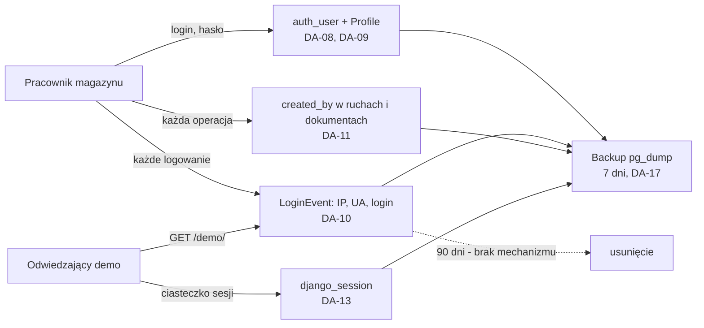

# RODO — dane osobowe w mini-WMS

| | |
|---|---|
| Wersja | 0.1 |
| Data | 2026-10-16 |
| Status | szkic — do akceptacji Product Ownera |
| Właściciel | [SEC] |

## 1. Zastrzeżenie i zakres

Dokument techniczno-organizacyjny: opisuje, jakie dane osobowe przetwarza aplikacja, jak
długo je trzyma i jak technicznie zrealizować prawa osób. **Nie jest poradą prawną.**
Podstawy prawne, role (administrator / podmiot przetwarzający) i treści klauzul wymagają
oceny prawnika lub inspektora ochrony danych; wszystko, co od niej zależy, oznaczono
„do potwierdzenia”. Wspiera hipotezę z audytu R7 ([`docs/AUDYT.md`](../AUDYT.md) §3.3)
i założenia Z-09, Z-14, Z-15 ([`ZALOZENIA.md`](../analiza/ZALOZENIA.md)). Zasoby danych (DA-xx):
[`KLASYFIKACJA_DANYCH.md`](KLASYFIKACJA_DANYCH.md); zagrożenia: [`THREAT_MODEL.md`](THREAT_MODEL.md).



## 2. Role

| Rola RODO | Kto | Uwagi |
|---|---|---|
| Administrator danych — wdrożenie u klienta | firma wdrażająca aplikację u siebie (ST-07) | decyduje o celach i środkach, retencji, klauzulach informacyjnych i obsłudze praw osób; scenariusz „wdrożenie” (Z-04, Z-14) |
| Dostawca / autor | podmiot utrzymujący kod (ST-08) | gdy klient sam hostuje i autor nie ma dostępu do danych — nie przetwarza danych klienta; gdy autor hostuje lub administruje instancją klienta — podmiot przetwarzający (umowa powierzenia, art. 28) — **do potwierdzenia (Z-15)** |
| Administrator danych — publiczne demo | autor jako operator usługi | dotyczy IP i user-agenta odwiedzających — **do potwierdzenia (Z-15)** |
| Odbiorcy i podmioty przetwarzające | dostawca VPS/hostingu; GitHub (kod, bez danych aplikacji); Let's Encrypt (certyfikat domeny) | umowa powierzenia z hostingiem po stronie administratora; lokalizacja serwera — do uzupełnienia przez PO |
| Kontakt w sprawach danych osobowych | do uzupełnienia przez PO | adres nie jest wpisywany do publicznego repozytorium (zasada 8 w [`KLASYFIKACJA_DANYCH.md`](KLASYFIKACJA_DANYCH.md) §4) |
| Inspektor ochrony danych | nie wyznaczono | potrzeba do oceny przez administratora (zwykle nie dla małej firmy) |

## 3. Kategorie osób i danych

| Osoby | Dane | Źródło | DA | Gdzie |
|---|---|---|---|---|
| Pracownicy magazynu (Operator, Podgląd, Administrator) | login, e-mail (opcjonalny), hash hasła, rola, status konta | formularz „Nowy użytkownik” (wpisuje Administrator) | DA-08, DA-09 | `auth_user`, `warehouse_profile` |
| Pracownicy | IP, user-agent (do 300 znaków), czas i rodzaj zdarzenia, login | automatycznie przy logowaniu, wylogowaniu i nieudanej próbie | DA-10 | `warehouse_loginevent` |
| Pracownicy | znacznik „kto” (`created_by`) przy materiałach, paletach, WZ, ruchach, spisach; kolumna „Kto” w eksporcie ruchów | automatycznie przy operacjach | DA-11, DA-14 | kolumny FK, eksport CSV/XLSX |
| Odwiedzający publiczne demo | IP, user-agent, czas; identyfikator sesji | automatycznie przy `GET /demo/` i „Wejdź jako demo” | DA-12, DA-13 | `warehouse_loginevent`, `django_session`, logi proxy |
| Osoby wpisujące dowolny tekst w pole „login” | wpisany tekst (do 150 znaków) — może zawierać cudzy login, e-mail, a nawet hasło | formularz logowania | DA-10 | `warehouse_loginevent.username` |
| Odbiorcy WZ (klienci, przewoźnicy — o ile osoby fizyczne) | nazwa w polu `reference`, `carrier`, `tracking_number` | wpisuje Operator (wolny tekst) | DA-06 | `warehouse_issuedocument` |

Nie przetwarzamy: danych szczególnych kategorii (art. 9), danych dzieci ani płatniczych.
Aplikacja nie ładuje zewnętrznych skryptów, analityki ani reklam (przegląd szablonów i JS);
ustawia wyłącznie ciasteczka niezbędne `sessionid` i `csrftoken`. Ocena obowiązku
informacyjnego o ciasteczkach — do potwierdzenia przez prawnika.

## 4. Cele i podstawy prawne

Propozycje do potwierdzenia przez PO i prawnika; **bez porady prawnej**.

| Cel | Dane | Proponowana podstawa | Uwagi |
|---|---|---|---|
| Uwierzytelnianie i zarządzanie dostępem | login, e-mail, hash hasła, rola | art. 6 ust. 1 lit. f (interes: kontrola dostępu do systemu); lit. b, jeśli pracownik jest stroną umowy z administratorem | do potwierdzenia |
| Bezpieczeństwo systemu i wykrywanie nadużyć | `LoginEvent` (IP, UA, login) | art. 6 ust. 1 lit. f | wymaga krótkiego testu równowagi (LIA); Z-09 |
| Rozliczalność zmian kont i uprawnień | `AuditEvent` (login autora i konta, akcja, wynik) | art. 6 ust. 1 lit. f | bez treści haseł; retencja 365 dni (Z-42); dostęp: Administrator |
| Rozliczalność operacji magazynowych | `created_by`, ruchy, kolumna „Kto” | art. 6 ust. 1 lit. f; lit. c, jeśli przepisy wymagają ewidencji | okres ewidencji ustala administrator |
| Ochrona publicznego demo przed nadużyciami | IP, UA odwiedzających | art. 6 ust. 1 lit. f | brak klauzuli informacyjnej — luka (§10) |
| Ciągłość działania (backup) | cała baza | art. 6 ust. 1 lit. f; art. 32 | retencja 7 dni |
| Logi techniczne serwera | adresy IP, ścieżki | art. 6 ust. 1 lit. f | retencja nieustalona (§6) |

## 5. Minimalizacja

Co można nie zbierać — rekomendacje [SEC] do decyzji PO.

| Dane | Po co | Można nie zbierać? | Rekomendacja |
|---|---|---|---|
| IP odwiedzających demo | brak realnej potrzeby: dane fikcyjne | tak | w trybie demo nie zapisywać IP w `LoginEvent` albo skracać (IPv4 do /24, IPv6 do /48) — US-005 |
| User-agent | diagnostyka incydentu | tak | nie zapisywać albo skracać do rodziny przeglądarki |
| Wpisany login w nieudanej próbie | wykrywanie ataków | częściowo | zapisywać tylko login istniejącego konta (TM-07) |
| E-mail pracownika | aplikacja nigdzie go nie używa (brak wysyłki poczty, brak resetu hasła) | tak — pole już opcjonalne | nie wymagać; rozważyć usunięcie pola |
| Kolumna „Kto” w eksporcie ruchów | analiza poza systemem | częściowo | ograniczyć do Operatora i Administratora (TM-29) |
| `reference` WZ (wolny tekst) | identyfikacja zamówienia | tak | w instrukcji: numer zamówienia zamiast nazwiska klienta |
| `created_by` | rozliczalność | nie | zostaje; anonimizowane przy usunięciu konta (`SET_NULL`) |

## 6. Retencja

Okresy propozycją do potwierdzenia przez PO. Status: **wdrożone**, **brak mechanizmu**,
**częściowo**, **do ustalenia**.

| Zasób | Okres | Uzasadnienie | Mechanizm | Status |
|---|---|---|---|---|
| `LoginEvent` (DA-10, DA-12) | 90 dni (Z-09, DEC-5) | bezpieczeństwo bez nadmiarowego przechowywania | `manage.py purge_login_events` + Scheduled Task (COOLIFY §10a) i przy starcie kontenera; w demo bez IP i UA (Z-38) | wdrożone (US-005, #23) |
| `AuditEvent` — dziennik audytowy (DA-10) | 365 dni (Z-42) | rozliczalność zmian uprawnień; bez IP i UA | `manage.py purge_login_events` (ta sama komenda i Scheduled Task) | wdrożone (US-022) |
| Sesje `django_session` (DA-13) | wygasają po 30 min bezczynności; fizyczne usunięcie codziennie | minimalizacja, rozdęcie tabeli w demo (R5) | wygaśnięcie logiczne: `base.py:185-186`; usuwanie: `manage.py clearsessions` w Scheduled Task | wdrożone (US-005, #23: `clearsessions` w Scheduled Task i przy starcie) |
| Konta (DA-08) | do dezaktywacji + N miesięcy (N — do ustalenia przez PO) | koniec stosunku pracy, rozliczenia | dezaktywacja: ekran „Użytkownicy”; usunięcie: `/admin/` (superuser) | częściowo (ręcznie) |
| `created_by` i ruchy (DA-07, DA-11) | okres ewidencji magazynowej (do ustalenia przez administratora; mogą dotyczyć przepisów księgowych) | rozliczalność | `on_delete=SET_NULL` anonimizuje znacznik po usunięciu konta; ruchów nie usuwamy automatycznie | wdrożone (anonimizacja); okres do ustalenia |
| Backupy (DA-17) | 7 dni (`BACKUP_KEEP_DAYS`) | ciągłość działania | `pg_backup.sh:24` (`find -mtime`) | wdrożone; dane usunięte z bazy zostają w kopiach do 7 dni |
| Logi kontenerów i proxy (DA-18) | nieustalone | zależne od Docker/Coolify | brak konfiguracji rotacji w repo | do ustalenia (RUNBOOK) |
| Eksporty i PDF (DA-14, DA-15) | nie przechowujemy | generowane na żądanie | — | n/d |
| Pliki importu (DA-16) | do końca żądania | przetwarzane w pamięci lub w pliku tymczasowym Django | automatycznie | wdrożone |
| Dane demo (DA-03) | 24 h | reset danych magazynowych | Scheduled Task `seed_demo --reset` (03:00) | wdrożone (dotyczy danych magazynowych, nie `LoginEvent`) |

## 7. Prawa osób i realizacja techniczna dziś

Termin odpowiedzi: miesiąc od żądania (art. 12). Aplikacja nie ma ekranów obsługi praw —
realizuje je administrator przez `manage.py shell`, po wykonaniu kopii zapasowej.

| Prawo | Jak dziś | Luka | Propozycja |
|---|---|---|---|
| Informacja (art. 13, 14) | brak klauzul w aplikacji | brak informacji dla pracowników i odwiedzających demo | krótka klauzula w stopce strony logowania (treść — PO i prawnik); klauzula pracownicza po stronie administratora |
| Dostęp (art. 15) | zapytanie ORM po loginie lub IP (fragment poniżej) | brak gotowego raportu | `manage.py export_user_data <login>` (Should) |
| Sprostowanie (art. 16) | rola i status: ekran „Użytkownicy”; e-mail: tylko `/admin/`; login się nie zmienia (klucz powiązań) | brak edycji e-maila w UI | zwykle bez znaczenia (e-mail nieużywany, §5) |
| Usunięcie (art. 17) | dezaktywacja konta + anonimizacja `username` w `LoginEvent` + usunięcie `User` w `/admin/` (fragment poniżej) | brak komendy; kopie zapasowe do 7 dni; ruchów nie usuwamy (rozliczalność) | `manage.py anonymize_user <login>` (Should); ocena prawna zakresu wyjątków |
| Ograniczenie (art. 18) | `is_active=False` — dane zostają, konto nie loguje | — | wystarczające |
| Przenoszenie (art. 20) | brak gotowej komendy; ręcznie CSV z ORM | brak | `export_user_data` w formacie JSON/CSV |
| Sprzeciw (art. 21) | dla podstawy lit. f: ocena indywidualna; w demo — zakończenie korzystania, IP znika po retencji | brak procedury | opis w RUNBOOK |

Dostęp (art. 15), uruchamiane w `manage.py shell`:

```python
from django.contrib.auth.models import User
from warehouse.models import LoginEvent, StockMovement

u = User.objects.get(username="<login>")
LoginEvent.objects.filter(user=u)                # udane logowania i wylogowania
LoginEvent.objects.filter(username=u.username)   # także nieudane próby (wolny tekst)
StockMovement.objects.filter(created_by=u)       # ruchy z jej udziałem
# odwiedzający demo: LoginEvent.objects.filter(ip="<adres>")
```

Usunięcie (art. 17), po dezaktywacji konta i wykonaniu kopii:

```python
LoginEvent.objects.filter(username=u.username).update(username="[usunięto]")
u.delete()   # created_by i LoginEvent.user -> NULL (SET_NULL); Profile usuwany kaskadowo
```

`LoginEventAdmin` nie pozwala edytować wpisów (`has_change_permission` = `False`), dlatego
anonimizacja idzie przez ORM, a nie przez `/admin/`.

## 8. Rejestr czynności przetwarzania (art. 30) — szkielet

Wypełnia administrator danych; wartości poniżej to propozycja wynikająca z kodu.

| Pole | CP-01 Konta i dostęp | CP-02 Dziennik logowań i bezpieczeństwo | CP-03 Rozliczalność operacji |
|---|---|---|---|
| Administrator | firma wdrażająca (nazwa do uzupełnienia przez PO) | firma wdrażająca; dla demo — autor (do potwierdzenia, Z-15) | firma wdrażająca |
| Cel | nadanie i odebranie dostępu, uwierzytelnienie | wykrywanie nadużyć i incydentów, ochrona demo | ustalenie, kto wykonał ruch, korektę lub wydanie |
| Podstawa | art. 6 ust. 1 lit. f (lub b) — do potwierdzenia | art. 6 ust. 1 lit. f — do potwierdzenia, LIA | art. 6 ust. 1 lit. f (lub c) — do potwierdzenia |
| Osoby | pracownicy magazynu | pracownicy, odwiedzający demo, osoby wpisujące dowolny login | pracownicy (Operator, Administrator) |
| Dane | login, e-mail (opcjonalny), hash hasła, rola, status | login/wpisany tekst, rodzaj zdarzenia, IP, user-agent, czas | login w `created_by`, kolumna „Kto” w eksporcie |
| Odbiorcy | Administrator aplikacji; administrator infrastruktury; hosting | Administrator aplikacji; administrator infrastruktury | wszyscy zalogowani (odczyt), w tym Podgląd |
| Transfer poza EOG | brak wg wiedzy; lokalizacja serwera do uzupełnienia przez PO | jak CP-01 | jak CP-01 |
| Retencja | do dezaktywacji + N (do ustalenia) | 90 dni (Z-09) — brak mechanizmu (US-005) | okres ewidencji (do ustalenia); anonimizacja przy usunięciu konta |
| Środki bezpieczeństwa | PBKDF2, role na serwerze, sesje, limit logowań (ASVS V2–V4); TM-35, TM-36 | dostęp tylko Administrator, HTTPS, limiter; TM-07, TM-39, TM-48 | transakcje i `StockMovement`, kontrola dostępu; TM-29 |

## 9. Incydenty

Naruszenie ochrony danych osobowych zgłasza administrator do organu nadzorczego **w ciągu
72 godzin** od stwierdzenia, jeżeli jest prawdopodobne ryzyko naruszenia praw lub wolności
(art. 33); osoby informuje przy wysokim ryzyku (art. 34); każde naruszenie dokumentuje się
w rejestrze naruszeń. Podmiot przetwarzający zgłasza administratorowi bez zbędnej zwłoki.
Dla publicznego demo administratorem jest autor (Z-15). Procedura techniczna:
[`RUNBOOK.md`](../operacje/RUNBOOK.md) (dokument powstaje równolegle).

| Scenariusz | Dane dotknięte | Pierwsze kroki techniczne |
|---|---|---|
| Wyciek lub kradzież backupu (TM-56) | wszystkie DA-05…DA-13 | rotacja `DJANGO_SECRET_KEY`, haseł bazy i superusera; wymuszenie zmiany haseł; unieważnienie sesji; ocena 72 h |
| Przejęcie konta Administratora lub superusera (TM-35, TM-36) | konta, dziennik, ruchy | dezaktywacja konta, zmiana haseł, przegląd `LoginEvent` i `StockMovement` z ostatnich dni |
| Ujawnienie dziennika logowań lub eksportu ruchów (TM-29, TM-39) | IP, UA, loginy | ustalenie zakresu osób i okresu, ocena ryzyka |
| Wyciek sekretu do repozytorium (TM-51) | zależnie od sekretu | natychmiastowa rotacja; historia git nie zastępuje rotacji |

Kontakt do zgłoszeń naruszeń: do uzupełnienia przez PO.

## 10. Otwarte pytania do PO

1. Czy administratorem danych odwiedzających demo (IP, user-agent) jest autor? Jaką treść
   ma mieć klauzula informacyjna w stopce strony logowania? (Z-15)
2. Czy retencja `LoginEvent` wynosi 90 dni (Z-09, DEC-5)? Czy w demo zapisujemy IP i
   user-agent wcale, skrócone, czy w pełni?
3. Czy zbieramy user-agent poza demo? Rekomendacja [SEC]: nie.
4. Jaki jest okres przechowywania kont po dezaktywacji (N) i ruchów magazynowych?
   Zależy od przepisów o ewidencji; potrzebna decyzja administratora.
5. Podstawa prawna dla pracowników: lit. f czy lit. b? Czy wykonujemy test równowagi (LIA)?
6. Czy rola Podgląd ma widzieć kolumnę „Kto” w eksporcie ruchów (TM-29)?
7. Kto hostuje instancję klienta — klient czy autor (umowa powierzenia)? Gdzie
   fizycznie stoi serwer (EOG)?
8. Jaki jest kontakt w sprawach danych osobowych i zgłaszania naruszeń?
9. Czy potrzebny jest inspektor ochrony danych?
10. Czy budujemy komendy `export_user_data` i `anonymize_user` (Should)?
11. Czy ciasteczka niezbędne wymagają informacji (polityka cookies)?
12. Czy `LoginEvent.username` w nieudanej próbie zapisujemy tylko dla istniejących kont
    (rekomendacja [SEC], TM-07)?
