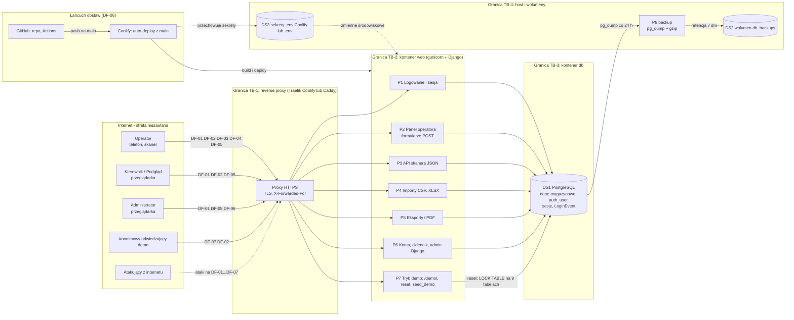

# Model zagrożeń (STRIDE)

| | |
|---|---|
| Wersja | 0.1 |
| Data | 2026-10-16 |
| Status | szkic — do akceptacji Product Ownera |
| Właściciel | [SEC] |

Model zagrożeń mini-WMS metodą STRIDE, prowadzony **per przepływ danych** (DF-01…DF-08).
Nie powtarza audytu: ryzyka R1–R10 i dług T1–T16 pochodzą z [`docs/AUDYT.md`](../AUDYT.md)
§2.4 i §3.3 i są tu wskazywane po identyfikatorze. Ocena prawdopodobieństwa i wpływu
oraz decyzje o akceptacji są w [`RYZYKA.md`](RYZYKA.md) (RR-xx), zasoby w
[`KLASYFIKACJA_DANYCH.md`](KLASYFIKACJA_DANYCH.md) (DA-xx).

## 1. Zakres i założenia

| Element | Treść |
|---|---|
| Co modelujemy | aplikacja Django `warehouse` (panel, skaner JSON, importy, eksporty/PDF, `/admin/`), obraz Docker, oba pliki compose, backup, tryb demo |
| Stan oceniany | `main` @ `f5be158` + audyt z 2026-10-15; poprawki wykonywane równolegle (m.in. US-006: CI, Dependabot, CODEOWNERS, `Dockerfile`) **nie są uwzględnione** — weryfikacja w wersji 0.2; numery linii (`plik:linia`) dotyczą tego stanu |
| Z-04 | oceniamy jak produkt do realnego wdrożenia u klienta, nie tylko portfolio |
| Z-05 | publiczne demo (`DEMO_MODE=1`) jest powierzchnią ataku dostępną anonimowo z rolą Operator; jego niedostępność to ryzyko wizerunkowe, nie utrata danych |
| Z-06 | jeden magazyn i jedna firma — brak kontroli obiektowej między użytkownikami (zagrożenia IDOR świadomie nie są mitygowane) |
| Wdrożenie | Coolify z Traefikiem (`docker-compose.coolify.yml`) albo własny Caddy (`docker-compose.yml`); jedno zaufane proxy (`DJANGO_TRUSTED_PROXY_COUNT=1`); gunicorn, 3 workery; PostgreSQL 16; backup w osobnym kontenerze |
| Poza zakresem | host/VPS i panel Coolify (konfiguracja, aktualizacje), DNS, konta GitHub, urządzenie operatora (telefon), ataki fizyczne i socjotechnika |
| Zasada wpisu | zagrożenie trafia do modelu tylko z realistycznym scenariuszem; „Stan”: **zmitygowane** (kontrola skuteczna), **otwarte** (luka do zamknięcia lub decyzji), **zaakceptowane** (świadomy wyjątek — wymaga akceptacji PO w [`RYZYKA.md`](RYZYKA.md) §3) |

### Aktorzy

| Aktor | Kim jest | Uprawnienia |
|---|---|---|
| Operator | magazynier na telefonie (skaner) lub komputerze | rola Operator: operacje magazynowe, skaner |
| Kierownik / Podgląd | przeglądarka, odczyt i raporty | rola Podgląd (kierownik może mieć też Administratora — pytanie w [`INTERESARIUSZE.md`](../analiza/INTERESARIUSZE.md)) |
| Administrator | zarządza kontami i czyta dziennik logowań | rola Administrator; superuser dodatkowo ma `/admin/` |
| Odwiedzający demo | anonimowa osoba z linku w README/YouTube | publiczna rola Operator na instancji demo |
| Atakujący z internetu | bez konta; w demo równoważny odwiedzającemu z wrogim zamiarem | brak |

## 2. Diagram przepływu danych (DFD)

| Granica | Między czym | Co przekracza | Zaufanie |
|---|---|---|---|
| TB-1 | internet ↔ reverse proxy | TLS, żądania HTTP, `X-Forwarded-For` | proxy kończy TLS; po stronie internetu zero zaufania |
| TB-2 | proxy ↔ gunicorn/Django | żądania HTTP, `X-Forwarded-Proto/For` | nagłówki proxy zaufane tylko przy `TRUSTED_PROXY_COUNT` > 0 |
| TB-3 | Django ↔ PostgreSQL | zapytania SQL, hasło w `DATABASE_URL` | sieć Docker hosta, bez TLS |
| TB-4 | kontenery ↔ wolumeny/env hosta | pliki backupu, zmienne środowiskowe | dostęp ma administrator infrastruktury |

## 3. Przepływy i zagrożenia

Kolumny: **Kat.** — S spoofing, T tampering, R repudiation, I information disclosure,
D denial of service, E elevation of privilege. „Powiązanie” wskazuje ryzyko w audycie
(R/T), pozycję rejestru (RR-xx), historyjkę (US-xxx), wyjątek (W-x) lub ASVS.
„Should” oznacza pozycję backlogu bez nadanego jeszcze numeru US.

### 3.1 DF-01 — Logowanie i sesja

Operator, Podgląd i Administrator przesyłają login i hasło `POST /login/`; limiter sprawdza
IP, `ModelBackend` weryfikuje hasło (PBKDF2), powstaje wiersz `django_session` i `LoginEvent`.
Zasoby: DA-08, DA-09, DA-10, DA-13.

| ID | Kat. | Zagrożenie | Istniejąca kontrola | Luka | Mitygacja | Powiązanie | Stan |
|---|---|---|---|---|---|---|---|
| TM-01 | S | Zgadywanie lub credential stuffing na `/login/` (znany login `admin` z `.env.docker.example`, konta demo) | limit 10 prób / 5 min / IP (`demo.py:32-33,62-75`), 4 walidatory haseł (`base.py:145-152`), PBKDF2 | limiter w LocMem **per proces** (3 workery → ok. 30 prób / 5 min / IP), brak limitu per konto, rozproszone IP, brak 2FA | wspólny cache lub limit na proxy; licznik per login; argon2; 2FA dla Administratora | R6 (Should) · RR-10 · W-4 | otwarte |
| TM-02 | S | Słabe hasło konta (min. 8 znaków; ASVS 2.1.1 wymaga 12) | walidatory Django: podobieństwo do loginu, min. długość, lista popularnych haseł, nie same cyfry (`base.py:145-152`) | `MinimumLengthValidator` bez `min_length` (domyślnie 8); brak sprawdzenia w bazach wycieków | `min_length` 12; opcjonalnie lista wycieków offline | R6 (Should) · RR-10 | otwarte |
| TM-03 | S | Przechwycenie sesji w tranzycie (MITM, downgrade do HTTP przy pierwszym żądaniu) | przekierowanie na HTTPS, ciasteczka `Secure`, HSTS, TLS na proxy (`prod.py:31-42`) | HSTS 30 dni (ASVS: ≥ 1 rok), `preload=True` bez efektu; konfiguracja TLS proxy niezweryfikowana | HSTS ≥ 1 rok albo bez `preload`; sprawdzenie TLS w RUNBOOK | R8 (Should) · RR-12 | otwarte |
| TM-04 | S | Fiksacja sesji (podsunięcie identyfikatora sesji przed logowaniem) | `login()` rotuje klucz sesji; wylogowanie czyści sesję | brak | — | ASVS 3.2.1 | zmitygowane |
| TM-05 | S | Zwolniony pracownik używa istniejącej sesji lub starego hasła | Django przy każdym żądaniu sprawdza `is_active` i hash hasła — dezaktywacja i zmiana hasła unieważniają sesje; bezczynność 30 min (`base.py:185-186`) | brak limitu bezwzględnego (`SESSION_SAVE_EVERY_REQUEST` odnawia sesję) — wpływ niski | opcjonalnie limit bezwzględny (np. 12 h) | ASVS 3.3.2 · RR-10 | zmitygowane |
| TM-06 | I | Enumeracja loginów przez komunikaty lub czas odpowiedzi | jeden komunikat „Niepoprawny login lub hasło” (`login.html`); Django hashuje hasło także dla nieistniejącego konta | brak | — | ASVS 2.2.1 | zmitygowane |
| TM-07 | I | Hasło wpisane przez pomyłkę w pole „login” trafia do `LoginEvent.username` (do 150 znaków), widoczne dla Administratora i w backupach | obcięcie do 150 znaków (`signals.py:130-140`) | zapis dowolnego tekstu bezterminowo | dla nieudanych prób zapisywać login tylko istniejącego konta; retencja 90 dni | R7 · US-005 · RR-11 | otwarte |
| TM-08 | D | Zalew `POST /login/` z wielu IP wyczerpuje CPU workerów (PBKDF2) | limiter odrzuca żądanie (429) **przed** hashowaniem (`demo.py:62-75`) | limit per IP i per proces; atak rozproszony go omija | rate limit na proxy (Traefik/Caddy), wspólny cache | R6 (Should) · RR-10 | otwarte |
| TM-09 | R | Fałszowanie IP w dzienniku i omijanie limitera przez `X-Forwarded-For` przy błędnej wartości `TRUSTED_PROXY_COUNT` | N-ty wpis od końca; przy 0 nagłówek ignorowany (`signals.py:81-99`, `docs/pitfalls/auth.md` #5) | wynik nie jest walidowany: błędna wartość trafia do pola `inet` → `DataError` (500) w sygnale logowania | `ipaddress.ip_address()` z fallbackiem na `REMOTE_ADDR` | AUDYT §3.3 „poza listą” · RR-17 | otwarte |

### 3.2 DF-02 — Panel operatora (formularze POST)

Przeglądarka wysyła formularze (przyjęcie, alokacja, korekta, wydanie, spis); widok sprawdza
rolę, serwis (`services.py`) zapisuje stan i `StockMovement` w jednej transakcji. Zasoby:
DA-05, DA-06, DA-07, DA-11.

| ID | Kat. | Zagrożenie | Istniejąca kontrola | Luka | Mitygacja | Powiązanie | Stan |
|---|---|---|---|---|---|---|---|
| TM-10 | E | Rola Podgląd wykonuje operacje Operatora albo nowy widok bez dekoratora jest publiczny | `role_required` (`roles.py:30-51`) na 47 widokach i 16 endpointach (AUDYT Zał. A), 35 asercji o 403 | brak testu macierzowego rola × trasa; brak globalnego „domyślnie odmów” | test iterujący po `urlpatterns` (rola × trasa × metoda) | RR-24 (Should) | otwarte |
| TM-11 | T | CSRF na operacjach zmieniających stan | `CsrfViewMiddleware` (`base.py:78`), ``, `SameSite=Lax`, zmiany tylko na POST (`docs/pitfalls/views.md` #1) | wyjątek: `GET /demo/` (TM-42) | — | ASVS 4.2.2 | zmitygowane |
| TM-12 | D | Przyjęcie z milionami palet blokuje workery i numerację HU dla wszystkich (R3) | brak (`forms.py:207-213` bez `max_value`; blokada licznika trzymana do końca żądania) | brak górnego limitu palet i ilości | `max_value`, limit palet na wiersz i HU na plik, walidacja przed zapisem | R3 · US-002 · RR-04 | otwarte |
| TM-13 | D | Listy bez paginacji (`hu_list`, `location_list`, `stock_by_location`, `report_locations`) zajmują worker do 120 s po rozroście danych | limit 500 ruchów na liście (`views.py:1162`) | brak paginacji i limitu | paginacja; limit łącznej liczby obiektów w demo | R5 (reszta, Should; DEC-6) · RR-07 | otwarte |
| TM-14 | T | Operator nadużywa uprawnień (korekta stanu, wydanie „na zapas”) | korekta wymaga powodu; każda zmiana to `StockMovement` w transakcji (`services.py`); spis z natury | insider z uprawnieniami — nie do wyeliminowania technicznie | przegląd korekt w raportach, spis z natury | RR-30 | zaakceptowane |
| TM-15 | R | Zaprzeczenie wykonania operacji przy współdzielonym koncie | `created_by` + `LoginEvent` | w demo konta współdzielone z założenia; u klienta możliwe współdzielenie | polityka „jedno konto = jedna osoba” w instrukcji wdrożeniowej | RR-09 · RR-30 · W-1 | zaakceptowane |
| TM-16 | I | Stored XSS przez pola wolnego tekstu (nazwa materiału, `reference`, `note`, `carrier`) | autoescape, brak `\|safe` i `mark_safe` (AUDYT §3.1); skaner używa `textContent` | brak CSP jako drugiej warstwy; inline handlery `onclick` | `django-csp` z nonce, usunięcie inline handlerów | R8 (Should) · RR-12 | otwarte |
| TM-17 | I | Odczyt cudzych danych przez zmianę `pk` w URL (IDOR) | brak — jeden magazyn, każdy zalogowany widzi wszystko w ramach roli | brak kontroli obiektowej (z założenia) | przy drugim magazynie/firmie: filtr w każdym querysecie (`docs/pitfalls/auth.md` #4) | Z-06 · RR-30 | zaakceptowane |
| TM-18 | I | Dane poprzedniego użytkownika w cache przeglądarki na współdzielonym terminalu hali | wylogowanie czyści sesję, więc serwer odrzuca kolejne żądania | odpowiedzi bez `Cache-Control: no-store` | `never_cache` lub middleware dla zalogowanych | ASVS 8.2.1 (Could) · RR-29 | otwarte |

### 3.3 DF-03 — API skanera JSON

Telefon operatora wywołuje 8 endpointów (`/skaner/api/…`), JS dołącza `X-CSRFToken`; serwis
zapisuje alokację, pobranie, przepakowanie lub korektę spisu. Zasoby: DA-05, DA-06, DA-07.

| ID | Kat. | Zagrożenie | Istniejąca kontrola | Luka | Mitygacja | Powiązanie | Stan |
|---|---|---|---|---|---|---|---|
| TM-19 | E | Wywołanie API bez sesji lub z rolą Podgląd | `@operator_required` + `@require_GET`/`@require_POST` na 8 endpointach (`scanner_views.py:150-411`) | brak | — | ASVS 4.1.1, 13.2.1 | zmitygowane |
| TM-20 | T | CSRF na POST API skanera | nagłówek `X-CSRFToken` z `window.CSRF` (`scanner/base.html:21`), brak `csrf_exempt` | brak | — | ASVS 13.2.3 | zmitygowane |
| TM-21 | T | Ilość lub `delta` spoza zakresu w JSON (ogromna, ujemna) → 500 lub wycofanie operacji | `CheckConstraint` ilość ≥ 0, `WMSError` w serwisach | brak górnej granicy; wartość > 2^31−1 daje `DataError` na PostgreSQL | `max_value`, obsługa `OverflowError` | T16 (Should) · RR-15 | otwarte |
| TM-22 | T | Rozjazd stanu WZ: `api_pick` zamyka dokument poza warstwą usług i bez blokady | pobranie palety w `services.pick_from_hu` z `select_for_update` | domknięcie dokumentu poza serwisem (`scanner_views.py:357-363`) | przenieść do `services.py` pod blokadą | T3 (backlog DEV) · RR-27 | otwarte |
| TM-23 | I | Szczegóły techniczne (stack trace) w odpowiedziach JSON | `DEBUG=False` (`prod.py:9`); odpowiedzi `{"ok": false, "error": …}` z komunikatem `WMSError` | brak | — | ASVS 7.4.1 | zmitygowane |

### 3.4 DF-04 — Importy CSV/XLSX

Operator wgrywa plik (lokalizacje, przyjęcia, stany, wydania); `upload.read()` trafia do
parsera w pamięci, wiersze przetwarza serwis w `@transaction.atomic`. Zasoby: DA-16, DA-05, DA-06.

| ID | Kat. | Zagrożenie | Istniejąca kontrola | Luka | Mitygacja | Powiązanie | Stan |
|---|---|---|---|---|---|---|---|
| TM-24 | D | Bomba w XLSX: mały plik rozpakowuje się do gigabajtów → OOM workera | limit 5 MB po kompresji (`forms.py:20-31`), `read_only=True`, w demo limit 500 wierszy (`imports.py:119-127`) | brak limitu po rozpakowaniu; `defusedxml` poza `requirements.txt`; poza demo brak limitu wierszy | suma `file_size` członków zip przed `load_workbook`; `defusedxml`; limit wierszy zawsze | R4 · US-004 · RR-05 | otwarte |
| TM-25 | D | Uszkodzony lub niezgodny z rozszerzeniem plik daje HTTP 500 (potwierdzone testem) | brak (`imports.py:92` nie łapie `BadZipFile`) | typ pliku rozpoznawany tylko po rozszerzeniu | magic bytes `PK\x03\x04`; `BadZipFile`/`InvalidFileException`/`KeyError` → `ImportError_` | T1 · US-004 · RR-05 | otwarte |
| TM-26 | D | Jeden wiersz importu przyjęć z liczbą palet rzędu milionów | brak (`receipt_import.py:54-59`) | brak limitu palet na wiersz i HU na plik | limit na wiersz i plik, walidacja przed zapisem | R3 · US-002 · RR-04 | otwarte |
| TM-27 | T | Kody i liczby z importu bez walidacji zakresu i długości → `DataError` na PostgreSQL i wycofanie całego importu | transakcja zbiorcza, część pól walidowana | brak `max_length` kodów (40) i numerów HU (30); `OverflowError` z `int(float("1e999"))` nieobsłużony | `max_length`, `max_value`, `except (…, OverflowError)` | T16 (Should) · RR-15 | otwarte |

### 3.5 DF-05 — Eksporty i PDF

Zalogowany użytkownik pobiera CSV/XLSX (stany, ruchy) lub PDF (etykiety HU i lokalizacji,
WZ); pliki powstają na żądanie i nie są przechowywane. Zasoby: DA-14, DA-15.

| ID | Kat. | Zagrożenie | Istniejąca kontrola | Luka | Mitygacja | Powiązanie | Stan |
|---|---|---|---|---|---|---|---|
| TM-28 | T | Wstrzyknięcie formuły (`=HYPERLINK(…)`) przez dane w eksporcie otwieranym w Excelu | `_safe_cell` poprzedza apostrofem komórki zaczynające się od `= + - @ \t \r`, w CSV i XLSX (`exports.py:9-15,27,46`) | ścieżka XLSX bez testu (pokrycie `exports.py` 53 %) | test XLSX | ASVS 5.2.2 (najbliższy punkt) | zmitygowane |
| TM-29 | I | Eksport ruchów ujawnia loginy pracowników (kolumna „Kto”) każdej roli, także Podglądowi | `login_required` (`views.py:1169-1208`) | brak ograniczenia roli i minimalizacji | decyzja PO: kolumna „Kto” tylko dla Operatora i Administratora | [`RODO.md`](RODO.md) §10 · RR-25 | otwarte |
| TM-30 | D | Eksport ruchów i stanów buduje wszystkie wiersze w pamięci | lista w UI ucięta do 500 ruchów | eksport bez zakresu dat | `StreamingHttpResponse`, filtr dat | T9 (backlog DEV) · RR-07 | otwarte |
| TM-31 | D | `GET /lokalizacje/etykiety/` renderuje QR dla wszystkich lokalizacji bez limitu (wystarczy rola Podgląd) | limit 200 dla etykiet HU (`views.py:502`) | brak limitu dla lokalizacji | limit jak `HU_LABELS_LIMIT` | R5 (reszta, Should) · RR-07 | otwarte |
| TM-32 | T | Nazwa pliku w `Content-Disposition` z kodu lokalizacji lub numeru HU zawierającego `"` albo CR/LF → `BadHeaderError` (500) | nazwy z numerów systemowych (AUDYT §3.1) | kody z importu nie są walidowane (`views.py:370,498`) | `django.utils.http.content_disposition_header()` | AUDYT §3.3 „poza listą” · RR-16 | otwarte |
| TM-33 | I | Pobrany eksport lub PDF poza kontrolą aplikacji (dysk, e-mail, chmura prywatna) | brak techniczna | — | zasady w [`KLASYFIKACJA_DANYCH.md`](KLASYFIKACJA_DANYCH.md) §4 | RR-30 | zaakceptowane |
| TM-34 | R | Brak śladu, kto i kiedy pobrał eksport z danymi osobowymi (np. przed odejściem z firmy) | log dostępu proxy (jeśli włączony) | brak zdarzenia audytowego w aplikacji | opcjonalny wpis audytowy przy eksporcie | ASVS 8.3.5 (Could) · RR-28 | otwarte |

### 3.6 DF-06 — Administracja kont i dziennik logowań

Administrator zakłada i edytuje konta (`/uzytkownicy/…`), czyta dziennik; superuser ma `/admin/`
(wyłączony przy `DEMO_MODE`, `config/urls.py:48-50`). Zasoby: DA-08, DA-09, DA-10, DA-07.

| ID | Kat. | Zagrożenie | Istniejąca kontrola | Luka | Mitygacja | Powiązanie | Stan |
|---|---|---|---|---|---|---|---|
| TM-35 | E | Administrator (nie superuser) zmienia hasło lub dezaktywuje konto superusera i loguje się do `/admin/` | `admin_required`; konta demo, własna rola i własny status chronione w `user_edit` | ~~brak sprawdzenia `is_superuser`~~ — od US-001: `user_edit` odmawia (403), lista bez linku (`views.py:1296-1335`) | konto superusera edytuje tylko superuser (403) + test | R1 · US-001 · RR-01 | zmitygowane (US-001) |
| TM-36 | S | Przejęcie konta superusera lub Administratora; `/admin/` dostępny z internetu bez 2FA | limiter, walidatory haseł; w demo `/admin/` wyłączony | brak 2FA i allowlisty IP | `django-otp` dla Administratora i `/admin/`; allowlista IP na proxy | R6 (Should) · RR-10 · W-2 | zaakceptowane |
| TM-37 | R | Superuser zmienia lub usuwa `StockMovement` i usuwa wpisy `LoginEvent` w `/admin/`, niszcząc ślad audytowy | zmiana i usuwanie tylko superuser (`admin.py`: `StockMovementAdmin`, `LoginEventAdmin`); `/admin/` wyłączony w demo | „tylko dopisywanie” jest konwencją, nie ograniczeniem bazy ani admina | `StockMovementAdmin` tylko do odczytu; usuwanie dziennika wyłącznie komendą retencji | R1 (scenariusz) · RR-23 | otwarte |
| TM-38 | S | Brak samodzielnej zmiany hasła: hasło ustawia Administrator, więc je zna (podszycie, brak rozliczalności) | `validate_password` przy ustawianiu hasła (`forms.py:149-158,175-179`) | brak widoku zmiany hasła; hasło początkowe nie wygasa | `PasswordChangeView` + wymuszenie zmiany przy 1. logowaniu | Z-16 (decyzja PO) · ASVS 2.1.5 · RR-22 | otwarte |
| TM-39 | I | Dziennik logowań (IP, user-agent, wpisany login) przechowywany bezterminowo — wyciek bazy lub backupu ujawnia nawyki logowania | dostęp tylko Administrator i superuser; paginacja 100 | brak retencji i mechanizmu usuwania (`models.py:510-538`) | `manage.py purge_login_events` (90 dni, Z-09) + Scheduled Task | R7 · US-005 · RR-11 | otwarte |
| TM-40 | R | Brak śladu zmian kont: kto, komu i kiedy zmienił rolę, hasło lub status | `LoginEvent` rejestruje tylko logowania | zmiany w `user_create` i `user_edit` nie są zapisywane | zdarzenie audytowe (log JSON lub model) | ASVS 7.1.3 (L2, Could) · RR-28 | otwarte |
| TM-41 | E | Nowe konto dostaje domyślnie rolę Operator zamiast najniższej (omyłka Administratora) | rolę wybiera Administrator jawnie | `initial=Role.OPERATOR` (`forms.py:141`) łamie zasadę najmniejszych uprawnień | domyślnie Podgląd | ASVS 4.1.3 (Could) · RR-28 | otwarte |

### 3.7 DF-07 — Tryb demo (login na GET, reset, publiczny Operator)

Odwiedzający wchodzi linkiem `GET /demo/` (loguje kontem `demo_operator` bez hasła) albo
„Wejdź jako demo”; dowolny Operator może wywołać „Przywróć dane demo”
(`seed_demo --reset --keep-users`). Zasoby: DA-03, DA-04, DA-12, DA-13.

| ID | Kat. | Zagrożenie | Istniejąca kontrola | Luka | Mitygacja | Powiązanie | Stan |
|---|---|---|---|---|---|---|---|
| TM-42 | S | Login CSRF: `` na obcej stronie loguje niezalogowaną ofiarę jako `demo_operator` | tylko `DEMO_MODE`; zalogowanych nie przelogowuje (`demo.py:113`); `X-Frame-Options: DENY`; konto publiczne, dane fikcyjne | `GET` zmienia stan sesji (świadomy wyjątek) | brak (wpływ pomijalny) | Z-05 · W-1 · RR-09 | zaakceptowane |
| TM-43 | E | Anonim wykonuje operacje Operatora (przyjęcia, wydania, importy) i wandalizuje dane demo | dane fikcyjne, reset (przycisk i Scheduled Task 03:00), import ≤ 500 wierszy, `/admin/` wyłączony, edycja kont demo zablokowana | z założenia | — | Z-05 · W-1 · RR-09 | zaakceptowane |
| TM-44 | D | Bot odpytuje `GET /demo/` i `POST /login/demo/` — każde trafienie to nowy wiersz `django_session` i `LoginEvent` (link jest w README i na YouTube) | brak — obie ścieżki omijają limiter `LoginView.post` | brak limitera i `clearsessions` | limiter per IP na obu ścieżkach; `clearsessions` w harmonogramie | R5 · US-005 · RR-06 | otwarte |
| TM-45 | D | Skrypt zalewa ścieżki operatora w demo (przyjęcia, importy, PDF) | brak limitu poza logowaniem | brak rate limitu na ścieżkach operatora | rate limit per IP w demo (proxy lub middleware) | R5 (reszta, Should; DEC-6) · RR-07 | otwarte |
| TM-46 | D | Anonim wywołuje „Przywróć dane demo” w pętli: `LOCK TABLE … EXCLUSIVE` na 9 tabelach w żądaniu HTTP | cooldown 60 s w LocMem (`demo.py:124-143`), blokada tabel (`seed_demo.py:116`) | cooldown per proces (do 3 resetów / min); dostępny anonimowo | reset tylko ze Scheduled Task | R5 (reszta, Should; DEC-6) · RR-08 | otwarte |
| TM-47 | D | Powtarzane importy (200 × 500 wierszy) i przyjęcia puchną bazę demo do następnego resetu | limit 500 wierszy na plik (`imports.py:119-127`); reset 03:00 | brak limitu łącznej liczby obiektów | limit liczby HU i lokalizacji w demo | R5 (reszta, Should; DEC-6) · RR-07 | otwarte |
| TM-48 | I | IP i user-agent odwiedzających demo zapisane w `LoginEvent` i sesjach bez retencji i klauzuli informacyjnej; `seed_demo --reset` ich nie czyści | brak | zbieranie IP anonimowych osób bez informacji i bez limitu czasu | w demo nie zapisywać IP/UA albo skracać; retencja; klauzula informacyjna | R7 · US-005 · RR-11 | otwarte |
| TM-49 | S | `seed_demo` bez `DEMO_MODE` zakłada `demo_operator` / `demo1234` (Operator) na instancji prywatnej | strażnik `DEMO_MODE` działa tylko przy `--reset` (`seed_demo.py:79`) | konta z jawnym hasłem poza demo | `seed_demo` odmawia bez `DEMO_MODE` albo `set_unusable_password()` | R2 · US-003 · RR-03 | otwarte |

### 3.8 DF-08 — Wdrożenie, sekrety, backup

Push do `main` uruchamia auto-deploy w Coolify; `entrypoint.sh` migruje bazę i zakłada
superusera z env; osobny kontener robi `pg_dump` co 24 h. Zasoby: DA-01, DA-17, DA-19, DA-20.

| ID | Kat. | Zagrożenie | Istniejąca kontrola | Luka | Mitygacja | Powiązanie | Stan |
|---|---|---|---|---|---|---|---|
| TM-50 | S | Start z domyślnymi sekretami: klucz `zmien-mnie-w-produkcji`, `admin` / `admin`, hasło bazy `wms`; zaślepki z `.env.docker.example` przechodzą walidację | wariant Coolify wymusza `${VAR:?}` (`docker-compose.coolify.yml:22,34,37,51`) | `docker-compose.yml:18,53,65` ma wartości domyślne; `prod.py:12` odrzuca tylko prefiks `django-insecure-`. Doprecyzowanie: sesje są w bazie, więc sam wyciek klucza nie pozwala ich podrobić — realnym wektorem jest `admin` / `admin` | `${VAR:?}` w obu compose; odrzucać klucze < 50 znaków i znane zaślepki | R2 · US-003 · RR-02 | otwarte |
| TM-51 | I | Wyciek sekretów z publicznego repozytorium, historii, obrazu lub logów CI | `.gitignore` i `.dockerignore` wykluczają `.env*`; `guard.py` blokuje zapis plików z sekretami; skan historii czysty (AUDYT §6) | gitleaks tylko miesięcznie i doradczo; brak pre-commit | gitleaks blokujący na PR, pre-commit | R10 · US-006 · RR-14 | otwarte |
| TM-52 | T | Atak na łańcuch dostaw: podatna lub podmieniona zależność, obraz bazowy po tagu, akcje po wersji głównej, `curl … \| sh` w CI | `pip-audit` czysty; `permissions: contents: read` w `security.yml` | skany doradcze; brak locka z hashami (T7), brak Dependabota, `ci.yml` bez `permissions` | Dependabot, pip-audit blokujący, akcje po SHA, lock z hashami | R10 · US-006 · RR-14 | otwarte |
| TM-53 | E | Złośliwy kod na `main` wdrożony automatycznie po przejęciu konta GitHub autora lub bez review | `guard.py` blokuje push na `main` (tylko w harnessie AI); merge wyłącznie PO (Z-02) | ochrona gałęzi, wymagany review i 2FA konta — poza repo, niezweryfikowane | branch protection, wymagany review, 2FA, CODEOWNERS | RR-21 · pytanie do PO | otwarte |
| TM-54 | T | RCE w parserze XLSX/PDF zyskuje trwałość: kod aplikacji jest zapisywalny przez użytkownika runtime | obraz non-root, bez kompilatorów | `chown -R app:app /app` (`Dockerfile:32-40`) | `/app` własności root, `chown` tylko `staticfiles` | AUDYT §3.3 „poza listą” · RR-18 | otwarte |
| TM-55 | D | Utrata bazy i kopii naraz: backup w wolumenie na tym samym hoście, bez off-site i testu odtworzenia | `pg_backup.sh` (co 24 h, retencja 7 dni) | wspólna awaria dysku i hosta; brak alertu o nieudanym backupie; odtworzenie nieprzećwiczone | kopia off-site, miesięczny test odtworzenia, alert | R9 · RR-13 · W-3 | zaakceptowane |
| TM-56 | I | Backup nieszyfrowany: dostęp do wolumenu daje całą bazę (hashe haseł, sesje, dziennik) | wolumen nieeksponowany, dostęp przez host | brak szyfrowania | szyfrowanie `age` lub `gpg` przed off-site | R9 (Should) · RR-13 | otwarte |
| TM-57 | I | Sekrety w env widoczne w panelu Coolify i przez `docker inspect`; hasło początkowe superusera zostaje w env (compose wymaga go przy każdym starcie, `docker-compose.coolify.yml:37`; konto tworzone raz — `entrypoint.sh:33-50`) | dostęp do panelu i hosta ma właściciel (do potwierdzenia) | brak procedury rotacji i 2FA do Coolify | zmiana hasła po 1. logowaniu (env staje się nieaktualne); rotacja i 2FA w RUNBOOK | RR-26 | otwarte |
| TM-58 | D | Awaria, błędy 500 lub atak niezauważone: brak alertów i monitoringu | logi JSON na stdout, `/healthz`, `HEALTHCHECK` | `ADMINS` puste, brak Sentry i alertu restartów | Sentry/GlitchTip lub `mail_admins`, alert w Coolify | T15 (Should) · RR-19 | otwarte |
| TM-59 | I | Logi (access log z `?q=`, logi JSON z wyjątkami, logi proxy) zawierają IP lub dane biznesowe bez zdefiniowanej retencji | brak danych osobowych w polach logu z założenia (AUDYT §3.3) | retencja zależna od Docker/Coolify | ustalić retencję i rotację w RUNBOOK | [`RODO.md`](RODO.md) §6 · RR-11 | otwarte |
| TM-60 | I | Podsłuch ruchu web ↔ db w sieci Docker (brak TLS do PostgreSQL) | sieć wewnętrzna hosta, port bazy nieopublikowany | brak szyfrowania | — (wymaganie L2) | ASVS 9.2.1 · RR-30 | zaakceptowane |

## 4. Podsumowanie

Łącznie **60 zagrożeń**: 8 zmitygowanych, 43 otwarte, 9 zaakceptowanych (wszystkie
zaakceptowane wymagają potwierdzenia PO w [`RYZYKA.md`](RYZYKA.md) §3 lub jako RR-30).

**Per kategoria STRIDE**

| Kategoria | Zmitygowane | Otwarte | Zaakceptowane | Razem |
|---|---|---|---|---|
| S — spoofing | 2 | 6 | 2 | 10 |
| T — tampering | 3 | 6 | 1 | 10 |
| R — repudiation | 0 | 4 | 1 | 5 |
| I — information disclosure | 2 | 10 | 3 | 15 |
| D — denial of service | 0 | 13 | 1 | 14 |
| E — elevation of privilege | 1 | 4 | 1 | 6 |
| **Razem** | **8** | **43** | **9** | **60** |

**Per przepływ**

| Przepływ | Zmitygowane | Otwarte | Zaakceptowane | Razem |
|---|---|---|---|---|
| DF-01 Logowanie i sesja | 3 | 6 | 0 | 9 |
| DF-02 Panel operatora | 1 | 5 | 3 | 9 |
| DF-03 API skanera | 3 | 2 | 0 | 5 |
| DF-04 Importy | 0 | 4 | 0 | 4 |
| DF-05 Eksporty i PDF | 1 | 5 | 1 | 7 |
| DF-06 Konta i dziennik | 0 | 6 | 1 | 7 |
| DF-07 Tryb demo | 0 | 6 | 2 | 8 |
| DF-08 Wdrożenie, sekrety, backup | 0 | 9 | 2 | 11 |

Wniosek: kontrole podstawowe (role na serwerze, CSRF, autoescape, ORM, sesje) działają —
w DF-03 zmitygowane są autoryzacja, CSRF i ujawnianie błędów. Zagrożeń
otwartych jest dużo, bo dominuje **dostępność** (13 z 14 zagrożeń D: brak limitów) oraz
**wdrożenie i dane osobowe**; zagrożenia o największym wpływie (TM-35, TM-50, TM-12/26,
TM-24) mają już historyjki US-001…US-004.

**Otwarte zagrożenia a backlog**

| Pozycja | Zagrożenia |
|---|---|
| US-001 (R1) | TM-35 |
| US-002 (R3) | TM-12, TM-26 |
| US-003 (R2) | TM-49, TM-50 |
| US-004 (T1/R4) | TM-24, TM-25 |
| US-005 (R7 + R5) | TM-07, TM-39, TM-44, TM-48 |
| US-006 (R10) | TM-51, TM-52 |
| Should (R6, R8, R9, T16, reszta R5, T3, T9, T15) | TM-01, TM-02, TM-03, TM-08, TM-13, TM-16, TM-21, TM-22, TM-27, TM-30, TM-31, TM-45, TM-46, TM-47, TM-56, TM-58 |
| Could / testy | TM-10, TM-18, TM-34, TM-40, TM-41 |
| Poza listą audytu (§3.3), bez US | TM-09, TM-32, TM-54 |
| Do decyzji lub potwierdzenia PO | TM-29, TM-37, TM-38, TM-53, TM-57, TM-59 |
| Wyjątki (W-1…W-4) | TM-15, TM-36, TM-42, TM-43, TM-55 |
| Akceptacja resztkowa (RR-30) | TM-14, TM-17, TM-33, TM-60 |

## 5. Co dodać w wersji 0.2

1. **Weryfikacja po poprawkach:** przegląd TM-12, TM-24…TM-26, TM-35, TM-49, TM-50…TM-52 po
   wdrożeniu US-001…US-006; zmiana stanu na „zmitygowane” tylko z odwołaniem do testu.
2. **Stan z drzewa roboczego:** uwzględnić równoległe zmiany CI (Dependabot, `permissions`,
   akcje po SHA, CODEOWNERS) i zaktualizować TM-51…TM-53.
3. **Infrastruktura poza repo:** konfiguracja Traefika/Caddy (nagłówki, TLS, access log,
   rate limit), ustawienia Coolify (2FA, dostęp, retencja logów), ochrona gałęzi `main` —
   do uzupełnienia przez administratora infrastruktury.
4. **Strona klienta skanera:** `scanner.js` i `demo.js` (DOM XSS, obsługa błędów,
   przechowywanie tokenów), biblioteka `jsQR` jako zależność zewnętrzna.
5. **Zależności jako powierzchnia ataku:** ReportLab, `qrcode`, `openpyxl`, WhiteNoise —
   parsery i generatory plików (przegląd CVE i sposobu użycia).
6. **Prywatność:** analiza LINDDUN dla DA-10, DA-11, DA-12 po decyzjach PO z
   [`RODO.md`](RODO.md) §10.
7. **Atak na biznes:** scenariusze nadużyć procesu (fałszywe etykiety QR, wydanie bez
   pokrycia, manipulacja spisem) razem z [BA].
8. **Testy dynamiczne:** potwierdzenie TM-12, TM-24, TM-44 na instancji testowej (nie na
   publicznym demo) i dopisanie testów regresji.
9. **Zmiany architektury:** model przy wdrożeniu Redis/DatabaseCache, drugiego magazynu
   (TM-17 przestaje być „zaakceptowane”) i samodzielnej zmiany hasła (TM-38).
