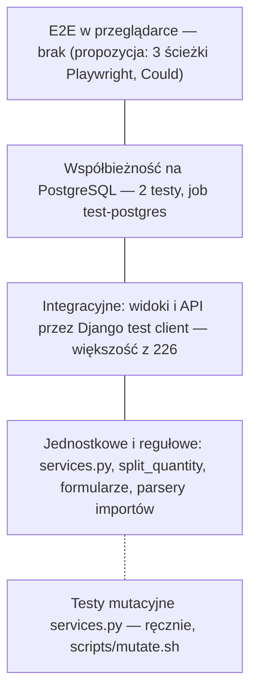
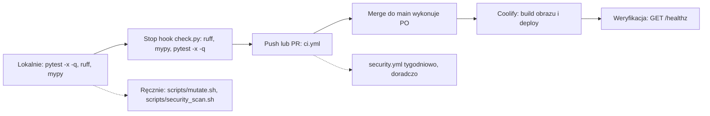

# Strategia testów

| | |
|---|---|
| Wersja | 0.1 |
| Data | 2026-10-16 |
| Status | szkic — do akceptacji Product Ownera |
| Właściciel | [DEV] |

Jak testujemy miniWMS: co jest dziś, jakie są progi, gdzie co się uruchamia, co dopisać.
Stan liczbowy pochodzi z [AUDYT §2.2–2.3](../AUDYT.md) (pomiar 2026-10-15) i z zliczenia funkcji
`test_*` w repozytorium (2026-10-16). Pipeline CI opisano w stanie docelowym wg
**ADR-0001** (`.github/workflows/ci.yml` przygotowany w tej samej serii zmian — potwierdzić po
scaleniu). Definition of Done całej funkcji jest w [CONTRIBUTING §4](../../CONTRIBUTING.md);
tu — Definition of Done **testów** (sekcja 9).

Powiązane: [ARCHITEKTURA](../architektura/ARCHITEKTURA.md) · [API](../architektura/API.md) ·
[MODEL_DANYCH](../architektura/MODEL_DANYCH.md) · [RUNBOOK](../operacje/RUNBOOK.md) ·
[docs/pitfalls/](../pitfalls/db.md).

---

## 1. Piramida testów

| Poziom | Co sprawdza | Narzędzie | Gdzie dziś | Stan |
|---|---|---|---|---|
| **Jednostkowe / regułowe** | reguły domenowe w `services.py` (FEFO→FIFO, limity, blokady stanu, korekty, spis), `split_quantity`, walidacja formularzy, parsowanie importów | Django `TestCase` / `SimpleTestCase`, `unittest.mock` | `tests.py`, `tests_services_fixes.py`, `tests_imports_fixes.py`, `tests_open_decisions.py` | jest; `services.py` 91 % |
| **Integracyjne** | widoki, role (403/302), API skanera, importy z plikiem, eksporty (CSV, formuły), PDF, tryb demo — przez klienta testowego z prawdziwą bazą | `django.test.Client` | `tests.py`, `tests_views_fixes.py`, `tests_scanner_fixes.py`, `tests_demo*.py`, `tests_recruiter.py` | jest; `views.py` 70 %, `exports.py` 53 % |
| **Współbieżność** | dwa równoległe wydania z jednej palety nie schodzą poniżej stanu | `TransactionTestCase` + wątki, **tylko PostgreSQL** | `tests_concurrency_pg.py` (2 testy; na SQLite pomijane) | jest; CI `test-postgres` |
| **Cały zestaw na PostgreSQL** | blokady `FOR UPDATE`, constrainty, typy | ten sam zestaw z `DATABASE_URL` | CI `test-postgres` | jest |
| **Bezpieczeństwa** | role, CSRF, nagłówki, limit uploadu, formuły CSV, hardening | `TestCase` | `tests.py` (`ViewAccessTests`, `SecurityTests`, `HardeningTests`), `tests_recruiter.py` | częściowe — brak macierzy rola × trasa (sekcja 5) |
| **Mutacyjne** | czy testy wykrywają zmiany w logice `services.py` | mutmut 3.8.0 | `scripts/mutate.sh` | brak zapisanych wyników (sekcja 6) |
| **E2E** | pełne ścieżki w przeglądarce, w tym JS skanera | Playwright (już w `requirements-dev.txt`) | **brak** | propozycja w sekcji 7 |
| **Operacyjne** | odtworzenie z kopii, deploy, rollback | procedury ręczne | [RUNBOOK](../operacje/RUNBOOK.md) | odtworzenie **nieprzećwiczone** (R9) |

---

## 2. Stan dziś

**226 testów w 12 plikach**, pełny zestaw ≈ 8 s (pytest, MD5 hasher); 224 przechodzą, 2 pomijane
na SQLite (współbieżność). Dodatkowo 4 testy hooków harnessu w `.claude/hooks/test_hooks.py`
(ukryty katalog — pytest domyślnie go pomija, więc nie wchodzą do liczby 226).

| Plik (`warehouse/`) | Testów | Obszar |
|---|---|---|
| `tests.py` | 113 | rdzeń: serwisy, picking, korekty, WZ, importy, skaner, spis, PDF, użytkownicy, role, bezpieczeństwo, hardening, widoki |
| `tests_services_fixes.py` | 18 | poprawki `services.py`: `split_quantity`, pojemność informacyjna (W-08), blokady wierszy, `adjust_hu_quantity` |
| `tests_views_fixes.py` | 17 | powód korekty, strona 403, linki powrotu, raport „bez limitu”, spis |
| `tests_recruiter.py` | 14 | „Wejdź jako demo”, panel powitalny, limit importu w demo, uprawnienia |
| `tests_demo_entry.py` | 13 | `/demo/` i limiter wejść |
| `tests_demo_limits.py` | 15 | limity obiektów i zapisów w demo, reset z harmonogramu (US-016) |
| `tests_urls.py` | 1 | migawka 72 tras: nazwa → adres i widok (US-017) |
| `tests_demo.py` | 12 | `seed_demo`, baner, konta demo, limit logowań, ochrona kont |
| `tests_open_decisions.py` | 12 | decyzje D-09…D-13 |
| `tests_scanner_fixes.py` | 9 | skaner: `specific_hu` (W-25), FEFO (W-11), powód korekty (W-26) |
| `tests_record_video.py` | 8 | `tools/record_video.py` (napisy, rozdziały — bez nagrywania) |
| `tests_demo_tour.py` | 4 | scenariusz prezentacji |
| `tests_imports_fixes.py` | 4 | import lokalizacji: pojemność 0, atomowość |
| `tests_concurrency_pg.py` | 2 | wyścig WZ (PostgreSQL) |

Konfiguracja: `pyproject.toml` → `[tool.pytest.ini_options]` (`DJANGO_SETTINGS_MODULE=config.settings.test`,
`python_files = tests.py tests_*.py test_*.py`, `-p no:cacheprovider`). Style: `TestCase`, klient
testowy, bez fixtures i fabryk, dane budowane w `setUp`.

### Pokrycie (pomiar audytu, `coverage`, bez migracji i testów)

| Moduł | Pokrycie | Uwaga |
|---|---|---|
| **ogółem** | **81 %** | próg 80 % |
| `services.py` | 91 % | próg 90 % |
| `models.py` | 93 % | |
| `forms.py` | 91 % | |
| `imports.py` | 77 % | |
| `scanner_views.py` | 74 % | ścieżki błędów |
| `views/` (pakiet) | 70 % | ścieżki błędów, eksport ruchów |
| `receipt_import.py` | 68 % | ścieżki błędów |
| `exports.py` | 53 % | **XLSX bez testu** |
| `config/log.py` | 29 % | `JsonFormatter` bez testu |

`pyproject.toml` w drzewie roboczym wyłącza z pomiaru także `tests_*.py` (wcześniej tylko
`tests.py`) — **liczba po zmianie może się różnić od 81 %**; pierwszy pomiar w CI jest nową
wartością bazową.

---

## 3. Progi pokrycia (Z-08, DEC-3 — do potwierdzenia przez PO)

| Próg | Wartość | Mechanizm |
|---|---|---|
| ogółem | **≥ 80 %** | `[tool.coverage.report] fail_under = 80` w `pyproject.toml`; `coverage report` w CI |
| `warehouse/services.py` | **≥ 90 %** | `coverage report --include=warehouse/services.py --fail-under=90` w CI |
| nowy kod | brak spadku | review: zmiana w `services.py` bez testu zatrzyma PR (próg 90 %) |

Wdrożenie w CI: ADR-0001, US-019.

Zasady: próg podnosimy, nie obniżamy (ratchet) — po domknięciu słabych modułów (sekcja 8) warto
rozważyć 85 % ogółem. Pokrycie jest **wskaźnikiem, nie celem**: 100 % linii bez asercji nic nie
dowodzi — stąd testy mutacyjne (sekcja 6). Raport HTML/XML jest artefaktem CI (14 dni).

---

## 4. Konwencje

| Aspekt | Zasada |
|---|---|
| Pliki | nowy obszar lub poprawka → `warehouse/tests_<obszar>.py`; `tests.py` zostaje rdzeniem. Przy dalszym rozroście rozważyć pakiet `warehouse/tests/` (`unit/`, `integration/`, `e2e/`) — dziś `python_files` wskazuje ręcznie |
| Klasy | `<Obszar>Tests(BaseSetup)`; `BaseSetup` (w `tests.py`) tworzy użytkownika `operator` (hasło `x`) i materiał — **bez** roli Operatora: sygnał nadaje `VIEWER`, więc test operacji ustawia rolę jawnie: `Profile.objects.filter(user=self.user).update(role=Role.OPERATOR)` |
| Rodzaje testów | `TestCase` (domyślnie, transakcja wycofywana); `SimpleTestCase` dla czystej logiki; `TransactionTestCase` tylko dla współbieżności |
| Nazwy | `test_<co>_<warunek>` po angielsku (Z-01), docstringi i komunikaty po polsku |
| Jednostka `PCS` | seeduje ją migracja `0002` → w testach `Unit.objects.get_or_create(code="PCS")` |
| Hasher | MD5 **tylko** w `config.settings.test` ([auth.md #11](../pitfalls/auth.md)); nie kopiować do `dev.py`/`prod.py` |
| PostgreSQL | testy zależne od blokad: `@unittest.skipUnless(connection.vendor == "postgresql", …)` jak `tests_concurrency_pg.py` ([db.md #2](../pitfalls/db.md)); test równoległości na SQLite niczego nie dowodzi |
| Limit logowań | testy POST na `/login/` czyszczą cache (LocMem, [auth.md #6](../pitfalls/auth.md)) |
| Tryb demo | `override_settings(DEMO_MODE=True)`; testy trasy `/demo/` też bez demo (oczekiwane 404) |
| Daty | względne (`timedelta`), bez `sleep`; dane demo zależą od dnia, więc nie asercjonować na stałych datach z `seed_demo` |
| Dane | wyłącznie syntetyczne; **żadnych danych osobowych**, e-maili, realnych nazw firm ([KLASYFIKACJA_DANYCH §4](../bezpieczenstwo/KLASYFIKACJA_DANYCH.md)); hasła testowe krótkie i oczywiste (`x`) — długie losowe ciągi wywołują fałszywe alarmy gitleaks (`.gitleaksignore`) |
| Zapytania | lista z relacją → `assertNumQueries` ([db.md #9](../pitfalls/db.md)) |
| Błędy | każdy test funkcji z walidacją pokrywa ścieżkę błędu (400/404/komunikat `WMSError`), nie tylko „happy path” |
| Regresja | bugfix zaczyna się od testu, który reprodukuje błąd (czerwony), potem poprawka ([CLAUDE.md](../../CLAUDE.md)) |

---

## 5. Testy bezpieczeństwa

### 5.1 Zasada: nowy endpoint = test odmowy dla każdej roli

Każdy nowy widok lub endpoint ma w tym samym PR:

1. test **anonimowy** → 302 na `/login/` (dla API skanera: 302, nie JSON),
2. test **każdej roli poniżej minimalnej** → 403 (Podgląd dla `O`/`A`; Operator dla `A`),
3. test **minimalnej roli** → nie 403 i nie przekierowanie na logowanie,
4. dla POST — test, że zmiana nie następuje przy odmowie (stan bez zmian), oraz przynajmniej
   raz test z `Client(enforce_csrf_checks=True)` (klient testowy domyślnie pomija CSRF).

Dekorator roli wykonuje się przed walidacją, więc testy odmowy **nie wymagają poprawnego
ładunku** (wystarczy np. `pk=1`).

### 5.2 Macierz rola × trasa ([AUDYT, Załącznik A](../AUDYT.md)) — zbudowana w US-007

Plik `warehouse/tests_access_matrix.py`: słownik `MATRIX` (nazwa trasy → `PUBLIC` / `LOGGED_IN` / `OPERATOR` / `ADMIN`).
**Nowa trasa = nowy wpis w `MATRIX`**, inaczej test kompletności jest czerwony i podaje nazwę trasy.
Pierwotny projekt (zrealizowany z drobną zmianą: zła metoda — 405 — też liczy się jako odmowa):

| Test | Idea |
|---|---|
| **Kompletność** | przejść po `get_resolver()`; każda nazwa trasy musi być w słowniku `ROLE_MATRIX` (`L`/`O`/`A`) albo w `PUBLIC` (`healthz`, `login`, `demo_*`…). Nowa trasa bez wpisu = czerwony test, więc autor musi zdecydować o roli (łapie „widok bez dekoratora” — [auth.md #1](../pitfalls/auth.md)) |
| **Odmowa** | dla każdej trasy i każdej roli poniżej minimalnej: anonim → 302, Podgląd → 403, Operator → 403 dla tras `A` (GET i POST) |
| **Dostęp** | minimalna rola nie dostaje 403/302 (200, 302 po operacji lub 404 dla nieistniejącego `pk`) |
| **Zasady szczególne** | superuser bez `Profile` = Administrator; trasy `DEMO_MODE` (`/demo/`, `/login/demo/`) zwracają 404 poza demo; zależność od `/admin/` wyłączonego w demo |

### 5.3 Testy regresji dla ryzyk z audytu

Każde ryzyko naprawiane z backlogu dostaje test, który czerwienieje bez poprawki.

| Ryzyko | Historyjka | Test regresji |
|---|---|---|
| **R1** — Administrator zmienia superusera | US-001 | POST na `/uzytkownicy/<pk superusera>/` jako Administrator bez `is_superuser` → 403; hasło i `is_active` bez zmian; superuser może edytować siebie |
| **R3** — nieograniczona liczba palet | US-002 | `ReceiveForm` odrzuca `pallets`/`total_quantity` powyżej limitu; import przyjęć z liczbą palet ponad limit → błąd wiersza, **zero** utworzonych HU; sprawdzenie przed pierwszym zapisem |
| **R2** — słabe sekrety/konta demo | US-003 | `prod.py` rzuca `ImproperlyConfigured` dla kluczy: zaślepka, wartość domyślna z compose, < 50 znaków (test przez przeładowanie ustawień z podmienionym env); `seed_demo` bez `DEMO_MODE` nie tworzy kont demo z działającym hasłem; kontrola, że `docker-compose.yml` nie ma domyślnych sekretów |
| **T1 / R4** — XLSX | US-004 | uszkodzony plik (`.xlsx` z losową treścią, CSV z rozszerzeniem `.xlsx`) na `/stany/import/`, `/lokalizacje/import/`, `/przyjecie/import/`, `/wydania/import/` → komunikat, nie 500; „bomba” (suma rozmiarów po rozpakowaniu ponad limit) odrzucona szybko; limit wierszy działa także poza demo |
| **R7 + R5** — dziennik, sesje, demo | US-005 | komenda retencji usuwa wpisy starsze niż 90 dni i zostawia nowsze; limiter na `/demo/` i `/login/demo/` zwraca 429 po przekroczeniu |
| **R10** — CI | US-006 | nie testy aplikacji; weryfikacja w CI (pliki `dependabot.yml`, `permissions` w `ci.yml`) |
| **T16** — zakresy | US-013 | `delta`/`quantity` poza zakresem kolumny oraz zapis wykładniczy w importach → 400/komunikat, nie 500 (dziś API zwraca 500 — potwierdzone, [API.md §9](../architektura/API.md)); kod lokalizacji z `"` lub znakiem nowej linii nie psuje `Content-Disposition` |
| **T3** — domknięcie WZ | US-018 | po przeniesieniu do `services`: dwa równoległe pobrania ostatnich pozycji kończą dokument raz (PostgreSQL) |

Pozostałe kontrole bezpieczeństwa uruchamia CI (bandit, semgrep, pip-audit, gitleaks, trivy —
[CONTRIBUTING §6](../../CONTRIBUTING.md), ADR-0001); nie zastępują one testów logiki dostępu.

---

## 6. Testy mutacyjne

| Aspekt | Zasada |
|---|---|
| Narzędzie | mutmut 3.8.0 (`pyproject.toml` → `[tool.mutmut]`), skrypt `scripts/mutate.sh <moduł> [wzorzec funkcji]` |
| Zakres | `warehouse/services.py` (cała logika zmieniająca stan); inne moduły na żądanie |
| Środowisko | Linux/WSL; na Windowsie skrypt sam uruchamia kontener `python:3.11-slim` (wymaga Dockera); pracuje na **kopii** repo |
| Czas | minuty–godziny — **nie** podpinać pod hooki ani pod CI na każdy PR |
| Wynik | `reports/mutation-<moduł>-<data>.md` (katalog `reports/` jest w `.gitignore`) — **brak zapisanych wyników** w repo |
| Interpretacja | przeżyły mutant = brakująca lub zbyt słaba asercja. Nie jest bramką; przeżyłe mutanty w logice ilości, blokad i FEFO przeglądamy ręcznie i dopisujemy testy |

Kiedy uruchamiać:

1. **Baseline** — raz, na całym `services.py`; raport zapisać (np. w załączniku do PR / opisie wydania), żeby mieć punkt odniesienia.
2. Po **istotnej zmianie** `services.py` (nowa funkcja, zmiana reguły) — z filtrem na zmienione funkcje.
3. Przed **oznaczeniem wydania** (tag), jeśli od baseline zmieniała się logika domenowa.
4. Po przeniesieniu logiki do serwisu (T3).

---

## 7. E2E — propozycja (Could)

Dziś nie ma testów w przeglądarce; JS skanera (`scanner.js`, `scanner_camera.js`) i przepływy
wielokrokowe są sprawdzane tylko ręcznie i pośrednio (API). Playwright jest już w
`requirements-dev.txt` (`playwright==1.63.0`) i w `tools/record_video.py` (film demo), więc
koszt wejścia jest niski.

| # | Ścieżka krytyczna | Kroki | Co dowodzi |
|---|---|---|---|
| E2E-1 | **Przyjęcie → etykieta → rozmieszczenie** | operator loguje się → `/przyjecie/` → HU „Do ułożenia” → `/skaner/rozmieszczanie/`: numer HU + kod lokalizacji (skaner jako klawiatura: kod + Enter) → komunikat → `/hu/` pokazuje „Zmagazynowany” w lokalizacji | sklejenie formularza, `services`, API i JS skanera |
| E2E-2 | **Wydanie według FEFO** | WZ z `seed_demo` → skaner „picking” → skan palety spoza kolejności FEFO → ostrzeżenie → dokończenie pozycji → status „Zrealizowany” → PDF WZ (`application/pdf`) | W-11, W-25, domknięcie WZ, PDF |
| E2E-3 | **Role i sesja** | Podgląd nie widzi akcji operatora, `/przyjecie/` → 403 w układzie aplikacji; wyczyszczenie ciasteczka sesji w skanerze → przekierowanie na `/login/` z komunikatem; „Wejdź jako demo” | uprawnienia widziane przez użytkownika, obsługa wygasłej sesji ([auth.md #10](../pitfalls/auth.md)) |

Zasady wdrożenia: serwer z `DEMO_MODE=1` + `seed_demo` (deterministyczne dane) uruchamiany w
tle; przeglądarka `playwright install chromium`; osobny job (nocny lub ręczny, nie na każdy
PR — czas i Chromium); kamery i `jsQR` **nie** testujemy (brak kamery w CI). Priorytet i
termin — decyzja PO ([BA]: wpis do backlogu).

---

## 8. Gdzie co się uruchamia

| Miejsce | Co | Kiedy | Blokuje? |
|---|---|---|---|
| **Lokalnie** | `python -m pytest -x -q` (`config.settings.test`, MD5), ≈ 8–40 s; PostgreSQL: z `DATABASE_URL` | w trakcie pracy | nie |
| **Stop hook** `.claude/hooks/check.py` | ruff + mypy na zmienionych plikach `warehouse/`, `config/` + `pytest -x -q` | przy zakończeniu pracy asystenta | tak (exit 2 → asystent poprawia) |
| **pre-commit** | ruff, gitleaks, higiena plików | przed commitem (opcjonalnie lokalnie) | tak lokalnie |
| **CI `ci.yml`** (stan docelowy, ADR-0001) | 1 ruff · 2 `mypy warehouse config` · 3 testy SQLite przez `coverage run -m pytest` + próg 80 % i `services.py` 90 % + `check`, `check --deploy`, `makemigrations --check` · 3b `pytest` na **PostgreSQL 16** (w tym wyścig) · 4 bandit + semgrep · 5 pip-audit · 6 gitleaks (pełna historia) · 7 build obrazu, smoke „healthy”, trivy | każdy push i PR | tak (HIGH/CRITICAL, próg pokrycia, błędy) |
| **`security.yml`** | pełniejszy skan doradczy (historia, system plików, wszystkie poziomy) | tygodniowo + ręcznie | nie |
| **Ręcznie** | `scripts/mutate.sh`, `scripts/security_scan.sh`, test odtworzenia z kopii | wg sekcji 6 i [RUNBOOK §5](../operacje/RUNBOOK.md) | nie |
| **Po deployu** | `GET /healthz` = 200 + kroki z `docs/operator/<branch>.md` | każdy deploy | procedura ręczna |

Historia stanu: do ADR-0001 CI uruchamiało testy przez `manage.py test` (~5 min, PBKDF2),
mypy tylko na 3 plikach i nie mierzyło pokrycia (T4–T6); to zamyka pipeline powyżej (po scaleniu zmian ADR-0001).

---

## 9. Definition of Done testów

Zmiana jest „zrobiona” w warstwie testów, gdy (uzupełnia [CONTRIBUTING §4](../../CONTRIBUTING.md)):

- [ ] każda nowa/zmieniona reguła domenowa ma test; **bugfix ma test regresji**, który bez poprawki jest czerwony,
- [ ] zmiana stanu: asercja na `StockMovement` (typ, `quantity_delta`, `created_by`) **i** na stan HU/dokumentu,
- [ ] nowy widok/endpoint: testy odmowy dla każdej roli i test minimalnej roli (sekcja 5.1); wpis w macierzy (5.2),
- [ ] zmieniony kontrakt API: test kontraktu + [API.md](../architektura/API.md) + CHANGELOG,
- [ ] ścieżki błędów pokryte (walidacja, `WMSError`, 400/404), nie tylko sukces,
- [ ] zmiana dotykająca blokad, constraintów lub migracji: uruchomiona na PostgreSQL (lokalnie lub `test-postgres` zielony),
- [ ] listy z nową relacją: `select_related`/`prefetch_related` + `assertNumQueries`,
- [ ] testy deterministyczne: bez `sleep`, bez zależności od bieżącej daty i kolejności,
- [ ] dane syntetyczne, bez danych osobowych i sekretów,
- [ ] `pytest -x -q`, `ruff check`, `mypy` zielone; próg pokrycia nie spadł (80 % / `services.py` 90 %),
- [ ] żaden test nie został usunięty, wyłączony ani osłabiony po to, by „przeszło” — uzasadnienie w PR, jeśli zmiana asercji jest konieczna.

---

## 10. Propozycje do backlogu testów

Priorytety MoSCoW to propozycja [DEV]; ustala je PO ([BA] wpisuje do `HISTORYJKI.md`).

| # | Zadanie | Powiązanie | Priorytet |
|---|---|---|---|
| 1 | Macierz rola × trasa (5.2) | US-007, [AUDYT Zał. A](../AUDYT.md) | zrobione (#23) |
| 2 | Testy regresji R1–R4, T1 (5.3) | US-001…US-004 | Must |
| 3 | Test odtworzenia z kopii (procedura, nie kod) przed wdrożeniem u klienta | R9, US-012, [RUNBOOK §5](../operacje/RUNBOOK.md) | Should wg backlogu; warunek wdrożenia u klienta |
| 4 | Test fail-fast `prod.py` i seed bez `DEMO_MODE` | R2, US-003 | Must |
| 5 | Test XLSX w `exports.py` (+ neutralizacja formuł w XLSX) | `exports.py` 53 % | Should |
| 6 | Ścieżki błędów `receipt_import.py` (68 %) i `views.py` (70 %), eksport ruchów | luki pokrycia | Should |
| 7 | Baseline testów mutacyjnych `services.py` + zapisany raport | sekcja 6 | Should |
| 8 | Test kontraktu API (komplet kluczy JSON per endpoint) i CSRF z `enforce_csrf_checks=True` | [API.md §8](../architektura/API.md) | Should |
| 9 | `JsonFormatter` (`config/log.py`, 29 %) | luka pokrycia | Could |
| 10 | Testy zakresów (T16): zapis wykładniczy, wartości > 2^31−1, długość kodów | T16, US-013 | Should |
| 11 | E2E Playwright, 3 ścieżki (sekcja 7) | — | Could |
| 12 | Cykl `migrate` w górę i w dół na PostgreSQL dla migracji odwracalnych | [MODEL_DANYCH §2](../architektura/MODEL_DANYCH.md) | Could |
| 13 | Przeniesienie testów do pakietu `warehouse/tests/` (podział jednostkowe/integracyjne/e2e) | AUDYT §2.3 | Could |

---

## 11. Historia zmian dokumentu

| Wersja | Data | Zmiana |
|---|---|---|
| 0.1 | 2026-10-16 | szkic: piramida, stan, progi, bezpieczeństwo, mutacje, E2E, DoD |
